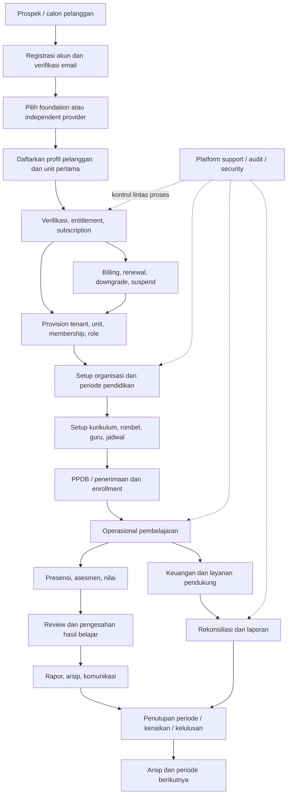

# SINAU — Peta Proses Bisnis End-to-End

**ID dokumen:** BP-MAP-001  
**Versi:** 0.1.0 — Draft baseline untuk validasi  
**Tanggal:** 2026-11-18  
**Status:** Draft; bukan persetujuan final seluruh fitur atau MVP  
**Pemilik keputusan:** Product owner SINAU  
**Induk:** [Master Blueprint](../01-blueprint/MASTER-BLUEPRINT.md)  
**Katalog:** [Blueprint Catalog](../01-blueprint/BLUEPRINT-CATALOG.md)  
**Tracker:** [Project Progress](../00-governance/PROJECT-PROGRESS.md)

> Dokumen ini memetakan proses lintas peran dari pelanggan mendaftar sampai aktivitas pendidikan, administrasi, pelaporan, dan penutupan periode. Ia menjadi peta induk untuk diturunkan menjadi spesifikasi proses dan spesifikasi modul. Detail field, aturan formula, SLA, tarif, regulasi, dan keputusan operasional yang belum disetujui sengaja ditandai terbuka.

## 1. Tujuan dan batas

Peta proses ini bertujuan:
- Menyamakan pemahaman tentang cara kerja SINAU dari sisi pelanggan, unit pendidikan, pengguna, dan platform.
- Menentukan pemicu, aktor, urutan, keputusan, hasil, pengecualian, dan jejak audit.
- Menemukan dependensi antarmodul sebelum desain database/API/UI.
- Menjadi sumber traceability: proses → requirement → modul → data/API → permission → layar → test case.
- Memisahkan kemampuan platform SaaS dari proses operasional sekolah/madrasah.

Peta ini **tidak** berarti seluruh proses otomatis masuk MVP. Prioritas dan release boundary tetap mengikuti [MVP Scope](../02-requirements/MVP-SCOPE.md) dan persetujuan product owner.

## 2. Prinsip proses yang berlaku untuk semua domain

1. **Scope eksplisit:** setiap transaksi berjalan pada konteks platform, tenant, atau education unit. Tahun ajaran/semester ditetapkan bila relevan.
2. **Akses berbasis grant:** tenant membership tidak otomatis memberi akses ke semua data unit. Role, permission, hubungan pengguna dengan data, dan status membership diperiksa di server.
3. **Satu sumber data:** data induk memiliki modul pemilik; modul lain menggunakan kontrak yang disepakati, bukan membuat salinan liar.
4. **Lifecycle jelas:** status, transisi yang sah, pembatalan, koreksi, dan alasan perubahan ditentukan per proses.
5. **Audit:** tindakan sensitif, persetujuan, perubahan nilai, transaksi keuangan, perubahan role, dan akses istimewa harus dapat ditelusuri.
6. **Tidak menghapus histori:** mutasi, kelulusan, pergantian wali kelas, perubahan paket, dan penutupan periode mempertahankan histori sesuai kebijakan retensi.
7. **Idempotency:** request, webhook, import, dan job yang dapat diulang tidak boleh menggandakan transaksi.
8. **Kegagalan tertutup:** context tidak valid, permission tidak cukup, atau data lintas scope harus ditolak.
9. **Konfigurasi pendidikan:** sekolah umum dan madrasah, jenjang, kurikulum, serta periode efektif tidak boleh diasumsikan identik.
10. **Human approval:** proses bernilai tinggi atau berdampak legal/akademik/finansial membutuhkan otorisasi dan persetujuan sesuai matriks kewenangan.

## 3. Aktor utama

| Aktor | Tanggung jawab proses |
|---|---|
| Platform administrator/operations | Mengelola katalog platform, pelanggan, entitlement, support, keamanan, dan operasi |
| Platform finance/support | Menangani billing atau kasus dukungan sesuai segregasi tugas |
| Foundation owner/admin | Mengelola profil pelanggan yayasan, entitlement, dan daftar unit sesuai permission |
| Independent provider owner/admin | Mengelola pelanggan mandiri dan unitnya |
| Kepala sekolah/madrasah | Menyetujui kebijakan dan transaksi unit sesuai kewenangan |
| Operator/TU | Mengelola data induk, administrasi, pendaftaran, surat, dan pelaporan |
| Admin akademik/wakil kurikulum | Mengelola kalender, kurikulum, rombel, jadwal, dan proses akademik |
| Guru/wali kelas | Mengelola pembelajaran, presensi, asesmen, nilai, dan komunikasi sesuai penugasan |
| Bendahara/staf keuangan | Mengelola tagihan, penerimaan, pengeluaran, kas, rekonsiliasi, dan laporan |
| HR/kepegawaian | Mengelola data pegawai dan penugasan |
| BK/kesiswaan | Mengelola layanan dan catatan kesiswaan dengan pembatasan akses |
| Pustakawan/pengelola aset | Mengelola koleksi, sirkulasi, inventaris, dan pemeliharaan |
| Siswa/peserta didik | Mengakses layanan dan informasi miliknya sesuai kebijakan |
| Orang tua/wali | Mengakses informasi anak yang hubungan dan kewenangannya telah diverifikasi |
| Auditor/pengawas eksternal | Mengakses data/laporan yang diberikan secara sah dan terbatas |
| Integrasi/provider eksternal | Mengirim/menerima data melalui kontrak dan kredensial terkontrol |

Satu orang dapat memegang beberapa peran, tetapi konflik kepentingan dan pemisahan tugas tetap diperiksa. Akun platform tidak otomatis menjadi akun tenant.

## 4. Peta tingkat tinggi

## 5. Process register

| ID | Proses | Pemilik domain | Output utama | Tahap |
|---|---|---|---|---|
| BP-PLT-01 | Registrasi dan onboarding tenant | Platform/tenant admin | Tenant dan unit pertama | Foundation |
| BP-PLT-02 | Penambahan dan pengelolaan unit pendidikan | Tenant admin/platform | Unit terdaftar dan terkelola sesuai entitlement | Foundation |
| BP-PLT-03 | Verifikasi tenant dan unit | Platform verification officer | Status verifikasi dan keputusan terdokumentasi | Foundation |
| BP-PLT-04 | Subscription, entitlement, downgrade, suspend, reaktivasi | Tenant billing/platform finance | Hak layanan dan kuota sesuai kontrak | Foundation |
| BP-PLT-05 | Identity, invitation, membership, role, dan access | Platform/tenant/unit admin | Grant akses terkontrol dan dapat dicabut | Foundation |
| BP-PLT-06 | Lifecycle tenant dan unit (suspend, close, transfer, restore) | Tenant admin/platform | Status lifecycle dan histori tenant/unit | Foundation |
| BP-ORG-01 | Setup profil dan struktur lembaga | Operator/kepala | Master organisasi | Core |
| BP-ORG-02 | Setup kalender, tahun ajaran, kurikulum | Admin akademik | Periode dan struktur akademik | Core |
| BP-ADM-01 | PPDB/penerimaan peserta didik | Panitia/operator | Calon peserta didik diterima/ditolak | Candidate — post-MVP |
| BP-STD-01 | Registrasi siswa dan enrollment | Operator | Enrollment per unit/periode | Core |
| BP-STD-02 | Lifecycle lanjutan siswa; minimum MVP hanya status dasar dan penutupan enrollment | Operator/kepala | Riwayat status siswa | Core (minimum MVP) + Phase (workflow lanjutan) |
| BP-HR-01 | Profil pegawai minimum dan penempatan; assignment mengajar dimiliki BP-ACA-01 | HR/operator/kepala | Profil pegawai dan referensi penempatan | Core (minimum MVP) + Phase (HR lanjutan) |
| BP-ACA-01 | Setup kelas, rombel, mapel, penugasan | Admin akademik | Struktur pembelajaran | Core |
| BP-ACA-02 | Penyusunan dan publikasi jadwal lengkap | Admin akademik | Jadwal tervalidasi | Phase — post-MVP; sesi manual/minimal untuk MVP |
| BP-ACA-03 | Learning delivery dan LMS | Guru | Aktivitas pembelajaran | Phase — post-MVP; sesi minimal untuk MVP |
| BP-ATT-01 | Presensi siswa dan koreksi | Guru/operator | Catatan presensi tervalidasi | Core |
| BP-ASM-01 | Asesmen dan pengolahan nilai | Guru/admin akademik | Nilai tervalidasi | Core |
| BP-ASM-02 | Review formal, pengesahan, dan rapor | Wali kelas/kepala | Hasil belajar resmi | Phase — post-MVP; rekap sederhana MVP dari BP-ASM-01 |
| BP-STU-01 | Kesiswaan, BK, prestasi, pelanggaran | Kesiswaan/BK | Catatan dan tindak lanjut | Candidate |
| BP-FIN-01 | Tagihan, penerimaan, pembayaran | Bendahara | Status tagihan dan receipt | Candidate |
| BP-FIN-02 | Kas, bank, pengeluaran, jurnal, rekonsiliasi | Bendahara/kepala | Buku dan laporan keuangan | Candidate |
| BP-OPS-01 | Anggaran, pengadaan, persetujuan | Unit/bendahara | Rencana dan realisasi pengadaan | Candidate |
| BP-LIB-01 | Pengelolaan koleksi dan sirkulasi | Pustakawan | Status koleksi dan transaksi | Candidate |
| BP-AST-01 | Inventaris, aset, pemeliharaan | Pengelola aset | Register dan kondisi aset | Candidate |
| BP-DOC-01 | Surat, disposisi, dokumen, arsip | TU/kepala | Dokumen dan jejak disposisi | Candidate |
| BP-COM-01 | Pengumuman, notifikasi, komunikasi | Unit/guru | Pesan dan delivery status | Cross-cutting |
| BP-REP-01 | Laporan, dashboard, export | Tiap pemilik domain | Laporan sesuai scope | Cross-cutting |
| BP-DAT-01 | Import, validasi, koreksi, export | Operator/domain owner | Data terverifikasi | Cross-cutting |
| BP-SEC-01 | Audit, support access, incident | Platform security/ops | Bukti dan tindakan terkontrol | Cross-cutting |
| BP-CLS-01 | Penutupan periode dan transisi tahun | Admin akademik/kepala | Periode terkunci dan periode baru | Core |

Label Core/Phase/Candidate adalah klasifikasi perencanaan awal, bukan komitmen MVP. MVP final tetap harus disetujui terpisah.

## 6. Spesifikasi proses end-to-end

### BP-PLT-01 — Registrasi dan onboarding tenant

**Tujuan:** membuat pelanggan SaaS dan unit pendidikan pertama tanpa mencampur tipe pelanggan dengan jenis/jenjang pendidikan.

**Pemicu:** calon pelanggan memilih mulai registrasi.

**Aktor:** pendaftar, layanan email, platform onboarding.

**Alur utama:**
1. Pendaftar membuat akun global dengan nama, email, password, serta persetujuan ketentuan dan privasi.
2. Sistem mengirim verifikasi email; token sekali pakai memiliki masa berlaku.
3. Pendaftar memilih `foundation` atau `independent_provider`.
4. Foundation mengisi profil badan penyelenggara; independent provider mengisi profil satuan pendidikan.
5. Pendaftar memasukkan unit pertama: bentuk `school` atau `madrasah`, jenjang yang sesuai, nama, alamat, kontak, dan identifier jika tersedia.
6. Sistem menampilkan ringkasan dan meminta konfirmasi kewenangan pendaftar.
7. Server memvalidasi field, kombinasi bentuk/jenjang, duplikasi identifier tanpa membocorkan data pihak lain, dan kebijakan pendaftaran.
8. Dalam satu transaksi, sistem membuat tenant, unit pertama, tenant membership, unit membership, role awal, status verifikasi, dan audit.
9. Pengguna diarahkan ke onboarding dashboard dengan daftar persyaratan dan status.

**Keputusan/variasi:**
- Email belum diverifikasi: tenant operasional tidak diaktifkan.
- Identifier NPSN/NSM belum tersedia: boleh kosong saat registrasi sesuai ADR-004, lalu dilengkapi dalam proses verifikasi.
- Gagal membuat salah satu record: seluruh transaksi dibatalkan.
- Foundation dapat mendaftarkan unit umum, madrasah, atau campuran.
- Independent provider tidak membuat foundation profile.

**Output:** tenant, unit, membership, role, onboarding case, audit event.

**Aturan akses:** pendaftar bukan platform admin. Hak tenant dan unit diberikan terpisah; admin foundation tidak otomatis memperoleh akses akademik seluruh unit.

**Referensi:** [Registration and Onboarding Flow](REGISTRATION-AND-ONBOARDING-FLOW.md), ADR-001, ADR-003, ADR-004.

### BP-PLT-02 — Penambahan dan pengelolaan unit pendidikan

**Tujuan:** mengelola penambahan dan perubahan unit di bawah tenant yang sah, dengan pemeriksaan permission, entitlement, dan isolasi tenant/unit.

**Alur utama:** tenant admin berwenang mengajukan unit → server memvalidasi tenant context, membership, permission, status tenant, entitlement, identifier, dan kuota secara atomik → unit dibuat/diperbarui dengan audit → unit menjalani verifikasi terpisah melalui BP-PLT-03 bila diwajibkan. Membership unit tidak diberikan otomatis kepada seluruh tenant member.

**Batas proses:** BP-PLT-02 menangani provisioning dan pengelolaan operasional unit. Hak paket/kuota berada di BP-PLT-04; suspend, penutupan, transfer, dan pemulihan lifecycle tenant/unit berada di BP-PLT-06.

**Kontrol:** kuota harus tahan race condition; unit baru tidak otomatis memberi akses akademik; kegagalan transaksi tidak meninggalkan unit atau membership yatim.

### BP-PLT-03 — Verifikasi tenant dan unit

**Tujuan:** memeriksa kelayakan identitas pelanggan dan unit tanpa mencampur status verifikasi dengan lifecycle tenant atau subscription.

**Alur utama:** sistem membuat checklist sesuai tipe tenant/unit → pemilik mengunggah bukti melalui kanal privat → sistem memeriksa format/kelengkapan/keamanan file → reviewer berwenang menyetujui, meminta perbaikan, atau menolak dengan alasan → keputusan, reviewer, waktu, dan versi bukti diaudit → policy engine mengevaluasi status verifikasi bersama dimensi lifecycle dan subscription yang terpisah.

**Kontrol:** dokumen privat dan URL unduhan sementara; submission tepat waktu yang menunggu review internal tidak dihukum akibat antrean; reviewer tidak memperoleh akses data akademik.

**Terbuka:** dokumen legal resmi, sumber identifier, SLA review, dan mekanisme banding.

### BP-PLT-04 — Subscription, entitlement, downgrade, suspend, dan reaktivasi

**Tujuan:** mengelola hak penggunaan SaaS dan kuota sesuai paket/kontrak tanpa menghapus data atau mencampur state billing dengan verifikasi dan lifecycle.

**Alur utama:** tenant billing admin memilih paket/periode → sistem membuat checkout/change intent → pembayaran/aktivasi diverifikasi → subscription dan entitlement diperbarui dengan effective date dan audit → setiap operasi kuota memeriksa entitlement server-side dan transaction-safe → downgrade menampilkan dampak dan tidak menghapus data/unit → past due, suspend billing, cancel, expiry, dan reaktivasi mengikuti policy yang disahkan.

**Batas proses:** suspend/reaktivasi karena billing merupakan keputusan BP-PLT-04. Suspend/close operasional tenant/unit berada di BP-PLT-06; verifikasi identitas berada di BP-PLT-03.

**Terbuka:** paket/harga/trial, grace period, refund/prorata, dan perilaku unit yang melebihi kuota setelah downgrade.

### BP-PLT-05 — Identity, invitation, membership, role, dan access

**Tujuan:** mengatur pemberian, perubahan, dan pencabutan akses pengguna pada scope tenant/unit secara eksplisit.

**Alur utama:**
1. Tenant/unit admin dengan permission mengundang pengguna melalui email, scope, role awal, dan masa berlaku.
2. Server memvalidasi hak pemberi undangan, status tenant/unit, batas pengguna bila berlaku, dan kompatibilitas role-scope.
3. Sistem mengirim token undangan sekali pakai dengan expiry.
4. Penerima login/membuat identitas global dan menerima undangan.
5. Sistem mengaktifkan tenant membership dan/atau unit membership sesuai scope; akses unit tidak diwariskan otomatis.
6. Role assignment diberikan sesuai delegation ceiling, least privilege, dan audit.
7. Admin berwenang mengubah role, menangguhkan, atau mencabut membership; perubahan harus efektif pada request berikutnya.
8. Setiap request/API/file/export/job memeriksa identity, tenant/unit context, membership, role/permission, relationship, dan status resource di server.

**Pengecualian:** undangan expired/ditarik, email telah terdaftar, penerima sudah menjadi member, inviter kehilangan hak, tenant/unit suspended/closed, dan penerimaan ulang harus ditangani idempotently.

**Batas proses:** membership awal pendaftar dibuat sebagai bagian BP-PLT-01; BP-PLT-05 mengatur undangan anggota tambahan dan perubahan/pencabutan akses setelah onboarding. Hak fitur/kuota berasal dari BP-PLT-04, bukan dari role.

### BP-PLT-06 — Lifecycle tenant dan unit (suspend, close, transfer, restore)

**Tujuan:** mengelola lifecycle operasional tenant/unit secara terpisah dari billing, verification, dan membership. Spesifikasi rinci draft tersedia pada PLATFORM-TENANT-PROCESS-SPECIFICATIONS.md §14.

**Alur utama:** pemohon berwenang mengajukan suspend/close/transfer/restore → server memvalidasi scope, kewenangan, alasan, status, dependency, kewajiban, dan bukti → sistem menampilkan impact preview dan meminta approval → workflow menjalankan transisi dengan effective date → policy engine membatasi/memulihkan request, job, file, export, cache, search, dan integrasi → audit, notifikasi, arsip, dan postcondition diverifikasi.

**Batas proses:** suspend karena billing, downgrade, dan reaktivasi pembayaran tetap BP-PLT-04; hasil verifikasi tetap BP-PLT-03; grant/revoke membership individu tetap BP-PLT-05; provisioning/perubahan profil unit biasa tetap BP-PLT-02.

**Kontrol:** suspend satu unit tidak otomatis menghentikan unit lain; close tenant tidak boleh meninggalkan unit aktif; close bukan hard delete; restore tidak mengaktifkan membership revoked atau subscription tidak valid. Transfer lintas tenant memerlukan consent/authority pihak asal dan tujuan, legal/privacy review, manifest, keputusan data disposition, snapshot/checksum, preflight, cutover, post-transfer isolation/integrity test, dan reconciliation. Unit tidak boleh aktif di dua tenant sekaligus.

**Terbuka:** reason/approval suspend dan close, legal basis serta kategori data transfer, identifier dan kewajiban kontrak, retention/legal hold, restore dari closed, read-only/export, dan strategi cutover/rollback. Transfer tetap diblokir sampai OPEN-PLT-13, OPEN-PLT-14, dan OPEN-PLT-18 diputuskan.

### BP-ORG-01 — Setup profil dan struktur lembaga

**Alur utama:** admin unit mengisi profil → operator melengkapi alamat/kontak/identitas/legalitas → kepala/reviewer menyetujui field yang memerlukan approval → sistem menyimpan versi dan audit → profil dipakai modul lain.

**Cakupan:** identitas unit, struktur organisasi, jabatan, kontak, lokasi/ruang, konfigurasi lokal, branding sesuai entitlement.

**Aturan:** master platform seperti jenis/jenjang pendidikan memiliki governance terpusat; override tenant/unit hanya diperbolehkan melalui mekanisme terkontrol.

### BP-ORG-02 — Kalender, tahun ajaran, kurikulum, dan periode

**Alur utama:**
1. Admin akademik memilih tahun ajaran dan tanggal mulai/akhir.
2. Menetapkan semester/term dan kalender kegiatan/hari efektif.
3. Memilih versi kurikulum yang berlaku untuk bentuk dan jenjang unit.
4. Menyusun struktur kurikulum, kelompok/mapel, alokasi, dan aturan penilaian.
5. Reviewer memeriksa benturan tanggal, kelengkapan, dan kesesuaian konfigurasi.
6. Kepala/unit berwenang mengesahkan konfigurasi untuk periode tersebut.
7. Sistem mengunci versi konfigurasi yang sudah digunakan transaksi akademik; perubahan berikutnya menjadi versi/amendment dengan audit.

**Pengecualian:** perubahan kurikulum di tengah periode, kalender revisi, unit baru, dan perbedaan aturan sekolah umum/madrasah harus memiliki effective date dan dampak historis yang jelas.

### BP-ADM-01 — PPDB/penerimaan peserta didik

> **Release boundary:** post-MVP. Registrasi langsung siswa untuk pilot berada di BP-STD-01; ini tidak mengaktifkan workflow PPDB.

**Alur kandidat:**
1. Unit membuka gelombang pendaftaran, daya tampung, persyaratan, jalur, dan jadwal.
2. Calon peserta didik/orang tua mengisi formulir dan menyerahkan dokumen.
3. Sistem membuat nomor pendaftaran dan status awal.
4. Panitia memeriksa kelengkapan; meminta perbaikan bila kurang.
5. Panitia melakukan seleksi sesuai jalur dan kriteria yang dipublikasikan.
6. Hasil direview/disahkan pejabat berwenang.
7. Hasil disampaikan secara privat kepada pendaftar.
8. Pendaftar diterima melakukan daftar ulang dan melengkapi dokumen.
9. Setelah syarat terpenuhi, sistem membuat student profile atau mencocokkan identitas yang sudah ada, lalu membuat enrollment ke unit/periode.
10. Data pendaftar yang tidak diterima/menarik diri mengikuti kebijakan retensi.

**Pengecualian:** pendaftaran ganda, perubahan pilihan, keberatan, daftar tunggu, pembatalan, dan transfer dari sekolah lain.

**Terbuka:** apakah PPDB termasuk MVP; aturan seleksi per jenis lembaga/daerah; pembayaran pendaftaran; integrasi resmi.

### BP-STD-01 — Data siswa dan enrollment

**Alur utama:** operator membuat/mengimpor profil siswa → sistem memvalidasi identitas dan kemungkinan duplikasi → hubungan wali dicatat dan diverifikasi → siswa ditempatkan pada unit, tahun ajaran, tingkat, dan rombel → enrollment disahkan → akses siswa/wali dapat diaktifkan sesuai kebijakan.

**Invarian:** presensi, nilai, dan transaksi akademik terikat ke enrollment/periode yang benar, bukan hanya student_id. Profil identitas tidak boleh menjadi tempat menyimpan status kelas aktif tanpa histori.

**Pengecualian:** siswa pindahan, identitas belum lengkap, data ganda, perubahan wali, dan siswa yang memiliki lebih dari satu enrollment aktif (kebijakan masih terbuka).

### BP-STD-02 — Mutasi, cuti, nonaktif, kelulusan, dan alumni

> **Release boundary:** MVP hanya status enrollment dasar dengan alasan/tanggal efektif, histori, dan penutupan enrollment bila diperlukan. Transfer lintas unit, cuti formal, promosi massal, kelulusan formal, dan alumni adalah post-MVP.

**Alur utama:** permohonan/peristiwa dicatat → operator memeriksa kelengkapan dan kewajiban → pejabat berwenang menyetujui → enrollment ditutup/diperbarui dengan tanggal efektif dan alasan → histori akademik/keuangan diarsipkan sesuai permission → akses portal disesuaikan → dokumen keluaran diterbitkan bila sah.

**Larangan:** jangan memindahkan histori siswa ke unit tujuan secara otomatis. Transfer data memerlukan dasar, persetujuan, minimisasi, dan audit.

### BP-HR-01 — Data pegawai dan penugasan

> **Release boundary:** MVP dibatasi pada profil pegawai/guru minimal, status kerja dasar, dan penempatan yang dibutuhkan. Kontrak/HRIS lanjutan, cuti, presensi pegawai, payroll, dan offboarding workflow adalah post-MVP. TeachingAssignment/HomeroomAssignment dimiliki BP-ACA-01; HR hanya menyediakan referensi pegawai.

**Alur utama:** HR/operator membuat profil pegawai → dokumen/identitas diverifikasi → status kerja dan unit penempatan ditetapkan → kepala menyetujui → role aplikasi diberikan terpisah dari status kepegawaian → penugasan guru/mapel/rombel dibuat per periode → perubahan atau berakhirnya hubungan kerja menutup assignment dan akses sesuai tanggal efektif.

**Cakupan kandidat:** guru, tenaga kependidikan, jabatan, kompetensi, dokumen, kontrak, beban kerja, presensi/cuti. Payroll tidak dianggap masuk MVP.

### BP-ACA-01 — Setup kelas, rombel, mapel, dan penugasan

**Alur utama:** admin akademik membuat tingkat/kelas sesuai jenjang → membentuk rombel untuk tahun ajaran → menetapkan kapasitas/wali kelas → menetapkan mapel dari kurikulum versi aktif → menetapkan guru dan beban mengajar → memvalidasi benturan/kelayakan → mengesahkan struktur.

**Pengecualian:** perubahan guru, penggabungan/pemisahan rombel, siswa pindah rombel, mapel pilihan, kelas lintas program, dan penugasan sementara.

### BP-ACA-02 — Penyusunan jadwal

> **Release boundary:** timetable engine lengkap post-MVP. MVP tidak mensyaratkan penjadwalan periodik; sesi manual/minimal dapat dipakai sebagai konteks presensi/asesmen.

**Alur utama:** admin menentukan slot waktu, ruang, rombel, guru, dan mapel → sistem memeriksa benturan ruang/guru/rombel dan batasan kalender → admin memperbaiki konflik → pejabat menyetujui → jadwal dipublikasikan → perubahan jadwal mengirim notifikasi dan menyimpan versi.

**Terbuka:** algoritma penjadwalan otomatis, aturan jam pelajaran dan kalender berbeda antarjenjang.

### BP-ACA-03 — Pelaksanaan pembelajaran

> **Release boundary:** learning delivery lengkap dan LMS post-MVP. MVP hanya memerlukan konteks sesi minimal bila diperlukan untuk presensi/asesmen.

**Alur utama:** guru membuka sesi sesuai jadwal → memeriksa daftar enrollment aktif → mencatat materi/aktivitas/tugas/praktik → peserta mengakses tugas/materi sesuai role → guru memeriksa penyelesaian dan memberi umpan balik → aktivitas tersimpan pada periode dan kelas yang tepat.

**Batas:** SINAU dapat mengelola administrasi pembelajaran; fitur LMS penuh, konferensi video, dan konten digital kompleks perlu keputusan scope tersendiri.

### BP-ATT-01 — Presensi siswa dan koreksi

**Alur utama:**
1. Guru membuka sesi/daftar presensi pada unit, rombel, dan periode yang sah.
2. Sistem mengambil peserta dari enrollment aktif pada tanggal sesi.
3. Guru/operator mencatat hadir, terlambat, izin, sakit, atau alpa sesuai konfigurasi.
4. Sistem memvalidasi duplikasi berdasarkan siswa/enrollment, sesi, dan tanggal.
5. Rekap dihitung dari catatan sumber.
6. Siswa/wali dapat melihat informasi sesuai permission.
7. Koreksi diajukan dengan alasan dan bukti bila diperlukan.
8. Pihak berwenang menyetujui/menolak; nilai awal dan perubahan disimpan dalam audit.

**Pengecualian:** sesi dibatalkan, jadwal berubah, presensi offline/sinkronisasi terlambat, siswa pindah rombel pada hari efektif, dan koreksi setelah periode dikunci.

### BP-ASM-01 — Asesmen dan pengolahan nilai

**Alur utama:** guru membuat asesmen berdasarkan kurikulum/mapel/periode → menetapkan metode, bobot, rubrik, tanggal, dan peserta → nilai dimasukkan/impor → sistem memvalidasi rentang, duplikasi, dan kelengkapan → guru melakukan review → koreksi dicatat → nilai diserahkan untuk pengesahan.

**Aturan:** skala, bobot, formula, komponen, remedial, dan aturan khusus harus berversi menurut jenis lembaga, jenjang, kurikulum, dan periode. Jangan mengunci formula nasional tanpa sumber dan persetujuan.

### BP-ASM-02 — Review, pengesahan, rapor, dan arsip

> **Release boundary:** workflow pengesahan dan rapor formal post-MVP. MVP menyediakan penilaian dasar dan rekap sederhana melalui BP-ASM-01.

**Alur utama:** guru menyelesaikan nilai → wali kelas memeriksa kelengkapan dan catatan → admin akademik memeriksa konsistensi → pejabat berwenang mengesahkan → sistem menghasilkan rapor/transkrip dari snapshot data yang disetujui → dokumen diterbitkan kepada penerima berhak → koreksi setelah pengesahan melalui workflow amendment dengan versi lama tetap terlacak.

**Pengecualian:** nilai belum lengkap, siswa mutasi di tengah periode, remedial, pembatalan pengesahan, rapor dicetak ulang, dan perubahan kurikulum.

### BP-STU-01 — Kesiswaan, BK, prestasi, pelanggaran, kegiatan

**Alur umum:** laporan/rujukan dibuat → petugas memeriksa kewenangan dan urgensi → kasus/aktivitas ditetapkan kategori dan penanggung jawab → tindakan/pendampingan dicatat → pihak terkait diberi informasi sesuai dasar dan permission → kasus ditutup atau ditinjau ulang.

**Privasi:** catatan BK dan dukungan khusus merupakan data sangat terbatas; tidak otomatis tampil kepada guru, wali, atau orang tua secara penuh. Definisi akses, persetujuan, keselamatan, dan kewajiban hukum harus ditinjau sebelum implementasi.

### BP-FIN-01 — Tagihan, penerimaan, dan pembayaran

> **Release boundary:** domain keuangan adalah Candidate/roadmap dan di luar MVP saat ini. Belum ada spesifikasi rinci atau persetujuan implementasi; lakukan discovery dan change request terpisah sebelum desain domain/data.

**Alur kandidat:** bendahara membuat jenis tagihan dan aturan → tagihan diterbitkan ke pihak yang tepat → wali/siswa melihat tagihan → pembayaran dicatat melalui kanal yang disetujui → provider mengirim callback/webhook yang diverifikasi dan idempotent atau bendahara mencatat penerimaan manual → sistem merekonsiliasi nominal/referensi → status tagihan diperbarui → receipt diterbitkan → pembatalan/refund/selisih melalui workflow terotorisasi.

**Kontrol:** pisahkan pembuat tagihan, penerima pembayaran, pemberi refund, dan reviewer sesuai kemampuan organisasi. Jangan menyimpan data kartu/credential provider. Callback gagal tidak boleh dianggap sebagai pembayaran berhasil.

**Terbuka:** model akuntansi, pajak, provider, biaya, refund, cicilan, beasiswa, denda, dan kebijakan tagihan.

### BP-FIN-02 — Kas, bank, pengeluaran, jurnal, rekonsiliasi

**Alur kandidat:** transaksi/permintaan pengeluaran diajukan → bukti dilampirkan → persetujuan berjenjang sesuai limit → pembayaran dicatat → jurnal terbentuk menurut mapping akun → mutasi bank diimpor/dimasukkan → rekonsiliasi mencocokkan transaksi → selisih ditinjau → periode keuangan ditutup dan laporan disahkan.

**Kontrol:** transaksi yang telah diposting tidak dihapus diam-diam; koreksi melalui reversal/adjustment dengan audit. Chart of accounts, periode, metode akuntansi, dan laporan harus ditentukan sebelum implementasi.

### BP-OPS-01 — Anggaran dan pengadaan

**Alur kandidat:** unit menyusun kebutuhan dan estimasi → anggaran diperiksa → pejabat menyetujui → permintaan pengadaan dibuat → vendor/penawaran dievaluasi → pesanan disetujui → barang/jasa diterima dan diverifikasi → invoice dibayar → aset/inventaris diperbarui bila relevan → realisasi dibandingkan dengan anggaran.

**Terbuka:** RKS/RKT/RKAS, aturan belanja dan sumber dana per jenis lembaga harus divalidasi dari sumber resmi.

### BP-LIB-01 — Perpustakaan

**Alur kandidat:** pustakawan mengelola katalog dan eksemplar → anggota memperoleh hak pinjam → peminjaman memeriksa ketersediaan dan batas → pengembalian memperbarui status → keterlambatan/kerusakan ditangani sesuai kebijakan → stok dan laporan direkonsiliasi.

### BP-AST-01 — Inventaris dan aset

**Alur kandidat:** aset dicatat dari pembelian/hibah → diberi identitas dan lokasi → penanggung jawab ditetapkan → pemeriksaan kondisi berkala → pemindahan/peminjaman/pemeliharaan dicatat → penghapusan/hibah/penjualan memerlukan persetujuan dan dokumen → histori tetap tersimpan.

### BP-DOC-01 — Surat, disposisi, persetujuan, arsip

**Alur utama:** surat/dokumen diterima atau dibuat → metadata dan klasifikasi ditentukan → nomor/registrasi diberikan → pejabat mendisposisikan atau menyetujui → tugas ditugaskan dan dipantau → dokumen final disahkan → disimpan privat dengan retensi dan hak akses → pencarian/ekspor dilakukan sesuai izin.

Tanda tangan elektronik hanya melalui penyedia dan mekanisme yang sah; status tanda tangan harus dapat diverifikasi.

### BP-COM-01 — Pengumuman, notifikasi, dan komunikasi

**Alur utama:** pengirim memilih audiens berdasarkan unit/kelas/role/relationship → sistem menghitung penerima yang berhak → konten dan lampiran divalidasi → pesan dijadwalkan/dikirim melalui kanal yang aktif → delivery/read status dicatat jika provider mendukung → kegagalan di-retry secara terbatas → preferensi dan opt-out dihormati.

Jangan menampilkan data siswa kepada wali yang relasinya tidak aktif atau belum diverifikasi.

### BP-REP-01 — Dashboard, laporan, dan analitik

**Alur utama:** pengguna memilih laporan dan periode → server memeriksa scope/permission → definisi metrik dan sumber data diterapkan → hasil ditampilkan dengan filter → export dibuat sebagai file privat → penerima diverifikasi sebelum download → aktivitas export dicatat.

Laporan lintas unit hanya boleh tersedia bagi role yang secara eksplisit diberi kewenangan. Snapshot dan waktu pembaruan data harus jelas.

### BP-DAT-01 — Import, validasi, koreksi, dan export

**Alur utama:** operator memilih template dan scope → mengunggah file → sistem memindai dan memvalidasi format → preview menampilkan valid/invalid rows tanpa menulis data → operator memperbaiki atau mengonfirmasi → proses import berjalan dalam batch idempotent → hasil per baris dicatat → kegagalan dapat diulang tanpa duplikasi → data sensitif direview → export dibatasi scope dan diaudit.

### BP-SEC-01 — Audit, support access, dan incident

**Alur utama:** alert/laporan diterima → triage menentukan severity dan scope → akses investigasi diberikan least-privilege dan berbatas waktu → setiap akses support dicatat → mitigasi disetujui sesuai kewenangan → dampak data/tenant dievaluasi → pemulihan dan komunikasi dilakukan → post-incident review menghasilkan tindakan korektif.

Akses break-glass tidak boleh menjadi bypass permanen. Impersonation harus terlihat dan tidak boleh menghilangkan identitas operator dari audit.

### BP-CLS-01 — Penutupan periode, kenaikan kelas, dan kelulusan

**Alur utama:**
1. Admin akademik menetapkan tanggal cut-off dan checklist penutupan.
2. Sistem memeriksa presensi, nilai, pengesahan, tunggakan/administrasi yang relevan, dan status siswa.
3. Pemilik domain menyelesaikan pengecualian.
4. Kepala/pejabat mengesahkan penutupan periode.
5. Sistem membuat snapshot/arsip rapor, enrollment, konfigurasi, dan laporan.
6. Operator menyiapkan tahun ajaran baru, rombel, dan enrollment berikutnya.
7. Siswa dipromosikan, mengulang, lulus, atau memiliki status lain sesuai keputusan.
8. Akses periode lama menjadi read-only sesuai kebijakan; histori tetap dapat ditelusuri.

**Pengecualian:** siswa belum memenuhi syarat, nilai tertunda, mutasi, sengketa nilai, perubahan kalender, dan pembukaan kembali periode. Reopen memerlukan alasan, otorisasi, serta audit.

## 7. Variasi proses sekolah umum, madrasah, dan vokasi

| Area | Sekolah umum | Madrasah | SMK/MAK |
|---|---|---|---|
| Referensi kurikulum | Harus mengikuti versi dan aturan yang berlaku | Mengakomodasi struktur khas madrasah dan referensi Kemenag yang relevan | Mengakomodasi struktur vokasi yang berlaku |
| Struktur mapel | Dikonfigurasi per jenjang/kurikulum | Tidak diasumsikan identik dengan sekolah umum | Termasuk mapel/program keahlian bila relevan |
| Kalender | Kalender dan hari efektif unit | Kalender/ketentuan madrasah yang berlaku | Memperhitungkan praktik/PKL bila relevan |
| Penilaian/rapor | Template dan formula berversi | Komponen khas madrasah harus didukung jika disahkan | Asesmen praktik/kompetensi bila disetujui |
| Praktik kerja | Tidak diasumsikan | Tidak diasumsikan | PKL/mitra industri/pembimbing sebagai domain khusus |
| Regulasi | Sumber resmi dan tanggal efektif | Sumber resmi Kemendikdasmen/Kemenag sesuai kewenangan | Tambahan sumber vokasi/industri bila relevan |

Tabel ini adalah daftar variasi yang harus didiscovery, bukan definisi regulasi. Setiap aturan harus memiliki URL/sumber resmi, tanggal akses, versi, tanggal efektif, dan reviewer.

## 8. Cross-cutting control dan data ownership

| Kapabilitas | Pemilik utama | Konsumen | Kontrol wajib |
|---|---|---|---|
| Identity | Platform identity | Semua modul | Global identity, MFA/session, recovery |
| Tenant/unit context | Platform tenancy | Semua modul | Membership, scope resolver, default deny |
| Authorization | Platform security | Semua modul | Permission + relationship + resource policy |
| Audit | Platform governance | Semua modul | Actor, scope, action, target, timestamp, correlation |
| File storage | Platform infrastructure | Semua modul | Private by default, classification, scan, retention |
| Notification | Platform communication | Semua modul | Consent/preference, audience scope, delivery log |
| Import/export | Data services + domain owner | Semua modul | Preview, scope, validation, audit |
| Search/cache | Platform infrastructure | Semua modul | Tenant-aware index/key, invalidation |
| Queue/scheduler | Platform infrastructure | Semua modul | Scope propagation, revalidation, idempotency |
| Reference catalog | Platform/domain governance | Domain pendidikan | Versioning, effective date, controlled override |

## 9. Status lifecycle minimum yang perlu dispesifikasikan

Setiap modul harus memiliki state machine sendiri. Status berikut hanya kategori contoh, bukan enum final:
- Draft → submitted → under_review → approved/rejected/changes_requested.
- Active → inactive/suspended → reactivated/closed.
- Open → in_progress → completed/cancelled.
- Pending payment → paid/partially_paid/failed/refunded/void.
- Published → amended/superseded/archived.

Setiap transisi harus menyebut aktor yang berhak, prasyarat, efek data, notifikasi, audit, dan apakah transisi dapat dibatalkan.

## 10. Artefak turunan yang wajib dibuat

Business Process Map ini belum menggantikan spesifikasi rinci. Turunan wajib:
1. Persona, stakeholder, RACI, dan journey per aktor.
2. Business Process Specification per proses dengan BPMN/swimlane, business rules, exception matrix, SLA, dan approval.
3. Module Specification per modul: ownership, use cases, data, API/event, permission, UI, reports, test cases.
4. Logical ERD dan data dictionary yang konsisten dengan proses.
5. Authorization matrix: actor × scope × resource × action × relationship.
6. Screen flow/wireframe untuk proses kritis.
7. API/event/integration catalog.
8. Regulatory register per jenis/jenjang pendidikan.
9. Traceability matrix requirement → process → module → data/API → permission → screen → test.
10. UAT scenario pack untuk sekolah umum, madrasah, yayasan multi-unit, dan provider mandiri.

## 11. Pertanyaan terbuka dan keputusan yang tidak boleh diasumsikan

- Daftar persona dan kebutuhan yang sudah tervalidasi dengan pengguna nyata.
- Batas MVP dan release sequence final.
- Apakah PPDB, keuangan, perpustakaan, aset, surat, BK, portal wali, dan komunikasi masuk MVP atau fase berikutnya.
- Kebijakan identitas siswa lintas unit/tenant, siswa multi-enrollment, dan transfer data.
- Formula/komponen nilai, format rapor, kalender, kurikulum, dan sumber regulasi efektif.
- Chart of accounts, metode akuntansi, pajak, invoice, pembayaran, refund, dan rekonsiliasi.
- Approval matrix dan segregasi tugas per ukuran lembaga.
- SLA operasional, retention, RPO/RTO, serta kebutuhan offline.
- Integrasi pemerintah/provider yang benar-benar tersedia dan diizinkan.
- Terminologi dan variasi proses per daerah/jenis lembaga.

Setiap jawaban yang mengubah perilaku produk harus disahkan product owner dan dicatat pada requirement/ADR terkait.

## 12. Definition of complete untuk dokumen proses

Satu proses baru boleh berstatus **Accepted** jika:
- Tujuan, pemicu, owner, aktor, precondition, dan output jelas.
- Happy path, alternate path, exception, cancellation, dan recovery terdefinisi.
- Business rules, status transition, approval, dan segregation of duties jelas.
- Tenant/unit/period scope dan authorization jelas.
- Data owner, audit, privacy, retention, dan integrasi ditentukan.
- UI/report/notification dan acceptance criteria tersedia.
- Test scenarios mencakup positive, negative, boundary, concurrency/idempotency bila relevan.
- Perbedaan sekolah umum/madrasah/jenjang telah ditinjau.
- Sumber regulasi diverifikasi bila proses bergantung pada aturan.
- Pemilik proses dan product owner menyetujui.

**Status dokumen saat ini:** Draft baseline menyeluruh. Proses-proses perlu divalidasi dan dipecah menjadi spesifikasi rinci; belum ada proses yang otomatis berstatus Accepted hanya karena tercantum di sini.
