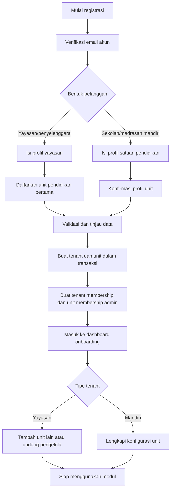

# Registrasi dan Onboarding Pelanggan SINAU

**Status:** Accepted product policy; alur operasional proposed untuk validasi sebelum implementasi  
**Tanggal:** 2026-11-18  
**Terkait:** ADR-001, ADR-003, PRODUCT-REQUIREMENTS.md, DOMAIN-MODEL.md

## 1. Tujuan

Menyediakan satu alur pendaftaran pelanggan dengan dua pilihan bentuk pelanggan:
1. Yayasan/penyelenggara pendidikan (`foundation`).
2. Sekolah/madrasah mandiri (`independent_provider`).

Pilihan tersebut menentukan tipe tenant. Pilihan itu tidak menentukan jenis atau jenjang pendidikan. Jenis dan jenjang dipilih ketika pengguna mendaftarkan education unit.

SINAU tidak membuat entitas yayasan fiktif untuk pelanggan mandiri. Sebaliknya, yayasan tidak perlu membuat akun tenant terpisah untuk setiap sekolah yang dinaunginya.

## 2. Peta alur

## 3. Langkah registrasi

### Langkah 1 — Akun pengguna pertama

Field minimum:
- Nama lengkap.
- Email aktif.
- Kata sandi sesuai kebijakan keamanan.
- Persetujuan syarat layanan dan kebijakan privasi.

Aturan:
- Email diverifikasi sebelum tenant aktif dapat digunakan.
- Akun pengguna global dan tidak diduplikasi untuk setiap tenant.
- Satu user dapat memiliki membership ke beberapa tenant jika diundang secara sah.
- Jangan menganggap pemilik email otomatis berhak mengelola yayasan atau sekolah yang namanya ia masukkan.
- Proses verifikasi kepemilikan/otorisasi organisasi dapat dilakukan bertahap sesuai risiko dan kebijakan onboarding.

### Langkah 2 — Pilih bentuk pelanggan

Tampilkan dua pilihan yang setara dan mudah dibedakan:

**A. Yayasan/penyelenggara pendidikan**
Deskripsi: "Kami mengelola satu atau beberapa sekolah/madrasah di bawah satu yayasan atau badan penyelenggara."

**B. Sekolah/madrasah mandiri**
Deskripsi: "Sekolah/madrasah kami mendaftar dan mengelola akun SINAU secara mandiri, tanpa akun yayasan."

Pilihan disimpan sebagai `tenants.tenant_type`:
- `foundation`
- `independent_provider`

Tipe ini tidak boleh diubah hanya melalui edit profil biasa. Perubahan tipe tenant memerlukan proses dukungan/migrasi yang diaudit karena berdampak pada struktur organisasi dan billing.

### Langkah 3A — Profil yayasan

Field:
- Nama resmi yayasan/badan penyelenggara (wajib).
- Nama singkat/brand (opsional).
- Bentuk badan penyelenggara (wajib; pilihan terkontrol, dengan "lainnya" bila diperlukan).
- Nomor pengesahan/identitas legal (opsional pada draft; dapat diwajibkan saat verifikasi/kontrak).
- Alamat kantor.
- Email dan nomor kontak organisasi.
- Nama pengurus/penanggung jawab pendaftar.
- Dokumen legal pendukung tidak wajib diunggah saat registrasi awal; dapat dilengkapi pada tahap verifikasi.
- Tenant dapat berstatus pending verification; fitur berisiko dapat dibatasi sampai pemeriksaan selesai.

Setelah profil yayasan, pendaftar harus mendaftarkan minimal satu unit pendidikan pertama agar tenant dapat menyelesaikan onboarding operasional.

### Langkah 3B — Profil sekolah/madrasah mandiri

Field:
- Nama resmi sekolah/madrasah (wajib).
- Bentuk satuan pendidikan: sekolah umum atau madrasah (wajib).
- Jenjang (wajib; pilihan bergantung bentuk satuan pendidikan).
- NPSN atau NSM/identitas resmi relevan boleh kosong saat registrasi awal dan dilengkapi saat verifikasi. Jika diisi, format, tipe, dan keunikannya divalidasi server-side.
- Alamat lengkap.
- Email dan nomor telepon unit.
- Nama kepala sekolah/madrasah (opsional pada draft).
- Data penyelenggara dapat dicatat sebagai informasi legal bila memang ada, tetapi tidak membuat tenant foundation secara otomatis.

Sistem membuat tenant `independent_provider` dan education unit yang terhubung langsung pada tenant tersebut.

### Langkah 4 — Data unit pendidikan pertama

Untuk tenant yayasan maupun mandiri, setiap unit memiliki field:
- Nama resmi unit.
- Bentuk pendidikan: `school` atau `madrasah`.
- Jenjang yang sesuai:
  - `school`: SD, SMP, SMA, SMK.
  - `madrasah`: MI, MTs, MA, MAK.
- NPSN/NSM atau identifier resmi relevan (nullable saat registrasi; dapat dilengkapi saat verifikasi).
- Alamat unit.
- Kontak unit.
- Status operasional.
- Zona waktu (default dari tenant, dapat dioverride bila kebijakan produk mengizinkan).

Daftar jenjang harus berasal dari reference catalog yang dapat dikembangkan, bukan hard-coded branching di seluruh modul. Validasi kombinasi bentuk pendidikan dan jenjang harus dilakukan server-side.

### Langkah 5 — Review dan konfirmasi

Sebelum membuat tenant:
- Tampilkan ringkasan akun, tipe pelanggan, profil organisasi, dan unit pertama.
- Pengguna mengonfirmasi bahwa ia berwenang mengajukan pendaftaran.
- Validasi field wajib, format identifier, duplikasi yang terdeteksi, dan konsistensi tipe/jenjang.
- Jika identifier resmi belum tersedia, biarkan nullable dan tandai verifikasi unit pending. Jangan mengarang nilai.
- Jika identifier diisi, validasi format dan keunikan; konflik ditangani tanpa mengungkap data lembaga lain.
- Jangan mengungkap data pelanggan lain saat mendeteksi duplikasi; tampilkan instruksi menghubungi dukungan.

### Langkah 6 — Buat tenant, unit, dan akses administrator

Pembuatan dilakukan secara atomik dalam satu transaksi database:
1. Buat `tenants` dengan `tenant_type` sesuai pilihan.
2. Buat `education_units` yang terhubung ke tenant.
3. Buat `tenant_memberships` untuk user pendaftar.
4. Berikan role tenant-scoped yang sesuai, misalnya `tenant_owner` atau `tenant_admin`.
5. Buat `unit_memberships` untuk unit pertama.
6. Berikan role unit-scoped yang sesuai, misalnya `unit_admin`.
7. Catat audit event untuk pembuatan tenant, unit, dan pemberian role.
8. Set status verifikasi/onboarding secara eksplisit.

Jika salah satu langkah gagal, seluruh transaksi dibatalkan. Jangan sampai tenant terbentuk tanpa unit pertama atau akun admin tanpa membership yang konsisten.

## 4. Hak akses akun pertama

| Tipe pelanggan | Membership tenant | Membership unit pertama | Batas penting |
|---|---|---|---|
| Foundation | `tenant_owner` / `tenant_admin` | `unit_admin` hanya pada unit yang didaftarkan atau ditugaskan | Tenant admin mengelola organisasi dan administrasi tenant; akses data akademik unit tetap membutuhkan grant unit |
| Independent provider | `tenant_owner` / `tenant_admin` | `unit_admin` pada unit mandiri | Tidak ada entitas yayasan; akses operasional hanya pada unit yang dimiliki tenant |

Prinsip:
- Pendaftar pertama tidak menjadi platform administrator.
- Role tenant dan role unit adalah assignment terpisah.
- Foundation tenant admin dapat mengelola daftar unit, undangan, paket, dan konfigurasi tenant sesuai permission.
- Label "admin yayasan" tidak otomatis memberikan akses ke seluruh data akademik unit. Jika produk menghendaki akses lintas unit, berikan permission eksplisit dengan scope yang jelas dan audit.
- Pengelola unit lain diundang dan diberi membership pada unit yang relevan.
- Perubahan/pencabutan membership harus langsung memengaruhi akses aktif.

## 5. Penambahan unit setelah onboarding

Penambahan unit tersedia bagi tenant foundation maupun independent_provider berdasarkan entitlement paket, bukan semata-mata tipe tenant. Paket dasar dapat memberi kuota satu unit; paket multi-unit berbayar dapat menaikkan kuota. Harga dan nama paket ditentukan terpisah.

Alur penambahan unit:
1. Tenant admin memilih "Tambah unit pendidikan".
2. Server memeriksa membership, permission, status subscription, dan sisa entitlement unit.
3. Jika kuota tersedia, admin mengisi profil, jenis/jenjang, dan identifier bila tersedia.
4. Sistem memvalidasi format dan konflik identifier tanpa membocorkan data tenant lain.
5. Unit dibuat di tenant yang sama; admin menugaskan pengelola unit.
6. Sistem membuat membership/role dan mencatat audit.
7. Jika kuota habis, penambahan ditolak dengan informasi paket dan jalur upgrade.

Tipe tenant tidak memberi kuota unit secara otomatis. Setiap unit tetap memiliki membership, permission, dan data akademik tersendiri.

## 6. Status lifecycle

Status lifecycle tenant, verifikasi, dan subscription merupakan dimensi terpisah.

Status tenant operasional:
- `draft`: registrasi belum lengkap.
- `active`: akses mengikuti subscription, entitlement, dan verification policy.
- `suspended`: akses operasional dibatasi berdasarkan kebijakan.
- `closed`: tenant ditutup sesuai proses retensi/ekspor data.

Status `suspended` wajib memiliki alasan dan sumber penangguhan (misalnya verification deadline, billing, atau kebijakan). Akses terbatas untuk penyelesaian verifikasi dan pengelolaan data tetap tersedia.

Status verifikasi tenant/unit: `not_started`, `pending`, `verified`, `requires_changes`, `rejected`.

Masa tenggang verifikasi adalah 7 hari kalender sejak onboarding berhasil diselesaikan (`registration_completed_at`). Sistem menampilkan tenggat dan mengirim pengingat. Jika persyaratan wajib belum dilengkapi sampai akhir hari ke-7, tenant otomatis `suspended`. Jika dokumen sudah diserahkan tepat waktu dan hanya menunggu pemeriksaan internal, tenant tetap `pending_verification` dan tidak disuspend karena antrean internal. Tenant suspended karena verifikasi hanya mendapat akses terbatas untuk login, melengkapi dokumen/identifier, melihat alasan, menghubungi dukungan, serta mengakses/mengekspor data sesuai hak. Data tidak dihapus. Setelah lolos verifikasi, tenant dapat diaktifkan kembali tanpa otomatis mengubah status subscription.

Status subscription mengikuti lifecycle billing tersendiri, misalnya `trial`, `active`, `past_due`, `suspended`, dan `cancelled/expired`. Tenant dapat terverifikasi tetapi subscription tidak aktif, atau sebaliknya. Policy akses harus mengevaluasi keduanya secara eksplisit.

Status unit:
- `draft`
- `pending_verification`
- `active`
- `inactive`

Status membership:
- `invited`
- `active`
- `suspended`
- `revoked`
- `expired`

Status harus memiliki transisi yang tervalidasi dan audit. Tenant yang belum terverifikasi dapat dibatasi pada onboarding, bukan diberi akses penuh.

## 7. Struktur data konseptual

### tenants
- `id`
- `tenant_type` — enum/reference: foundation, independent_provider
- `display_name`
- `legal_name`
- `status`
- `verification_status`
- `created_by_user_id`
- `created_at`, `updated_at`

### foundation_profiles
- `tenant_id` (PK/FK ke tenants)
- `legal_form`
- `legal_registration_number` (nullable)
- `office_address`
- `contact_email`
- `contact_phone`
- `responsible_person_name`

Profil foundation hanya ada untuk tenant bertipe foundation.

### education_units
- `id`
- `tenant_id`
- `unit_code` (internal, unik dalam tenant)
- `name`
- `education_form` — school/madrasah
- `education_level_id`
- `official_identifier_type` — NPSN/NSM/other
- `official_identifier` (nullable saat pendaftaran; dilengkapi dan diverifikasi kemudian)
- `address`
- `contact_email`, `contact_phone`
- `status`, `verification_status`
- `created_at`, `updated_at`

Constraint konseptual:
- `UNIQUE(tenant_id, id)`
- `UNIQUE(tenant_id, unit_code)`
- unique identifier resmi hanya bila nilainya tersedia dan aturan ruang lingkup keunikannya sudah ditetapkan.
- composite FK pada tabel unit-scoped harus menjaga pasangan `tenant_id, unit_id` berasal dari tenant yang sama.

### users
- `id`
- `name`
- `email` (unique global setelah normalisasi)
- `email_verified_at`
- `password_hash`
- `status`
- timestamp

### tenant_memberships
- `id`
- `tenant_id`
- `user_id`
- `status`
- `joined_at`, `expires_at`
- `invited_by_user_id`
- unique pasangan tenant dan user sesuai kebijakan membership.

### unit_memberships
- `id`
- `tenant_id`
- `unit_id`
- `user_id`
- `status`
- `joined_at`, `expires_at`
- `invited_by_user_id`
- composite FK `(tenant_id, unit_id)` ke `education_units(tenant_id, id)`.

### role assignments
- Tenant role assignment mengacu ke tenant membership.
- Unit role assignment mengacu ke unit membership.
- Role dan permission dipisah dari membership agar satu user dapat memiliki role berbeda pada scope berbeda.

Skema di atas adalah model konseptual, bukan perintah membuat migration final. Nama tabel, tipe kolom, index, cascade policy, dan constraint final harus diuji pada database engine yang dipilih.

## 8. Validasi dan keamanan

- Semua pilihan tipe tenant dan education level divalidasi di server.
- Jangan menerima `tenant_id`, `unit_id`, atau role istimewa dari input browser tanpa otorisasi server.
- Pembuatan tenant/unit/membership/role harus atomik dan idempotent untuk retry request.
- Gunakan rate limit dan proteksi spam pada registrasi, undangan, dan verifikasi.
- Simpan password dengan password hashing standar framework; jangan pernah log password/token.
- Email verification dan reset password harus menggunakan token sekali pakai yang kedaluwarsa.
- Cegah enumeration: respons untuk email/identifier yang sudah digunakan tidak membocorkan data pemiliknya.
- Semua perubahan status, membership, role, dan profil legal dicatat audit.
- File dokumen legal disimpan privat dengan akses terbatas dan URL sementara.
- Platform support tidak otomatis dapat melihat data siswa; akses khusus memerlukan alasan, scope, waktu, dan audit.

## 9. Acceptance criteria

1. Pendaftar dapat memilih yayasan atau mandiri dengan penjelasan yang tidak membingungkan.
2. Yayasan dapat mendaftarkan unit SD/SMP/SMA/SMK, MI/MTs/MA/MAK, atau kombinasi.
3. Sekolah/madrasah mandiri dapat selesai onboarding tanpa membuat foundation profile.
4. Jenis/jenjang unit tidak ditentukan oleh tenant type.
5. Akun pendaftar menjadi user global dan memperoleh tenant membership.
6. Akun pendaftar memperoleh unit membership hanya pada unit yang ditugaskan saat onboarding.
7. Pendaftar bukan platform admin.
8. Tenant foundation maupun independent provider dapat menambah unit berdasarkan entitlement paket.
9. Dokumen legal foundation boleh dilengkapi setelah registrasi dan status verifikasinya terlihat.
10. NPSN/NSM boleh kosong saat registrasi; identifier yang diberikan divalidasi tanpa membocorkan data pihak lain.
11. Verification status dan subscription status dapat berubah secara independen.
12. Tenant yang belum melengkapi persyaratan wajib sampai 7 hari kalender setelah pendaftaran selesai otomatis suspended.
13. Tenant yang sudah menyerahkan persyaratan tepat waktu tidak disuspend karena keterlambatan pemeriksaan internal.
14. Tenant suspended tetap dapat login secara terbatas untuk menyelesaikan verifikasi; data tidak dihapus.
15. Downgrade tidak menghapus unit atau data; penambahan unit baru dibatasi jika melewati entitlement.
16. Kegagalan saat pembuatan tenant/unit/membership tidak meninggalkan data parsial.
17. Tenant/unit yang pending verification dibatasi sesuai kebijakan.
18. Percobaan akses lintas tenant/unit ditolak dan tercatat bila relevan.
19. UI registrasi dapat digunakan melalui desktop dan ponsel serta menjelaskan istilah dengan bahasa sederhana.

## 10. Kebijakan yang sudah diputuskan dan hal terbuka

Sudah diputuskan dalam ADR-004: dokumen legal yayasan dapat menyusul pada tahap verifikasi; NPSN/NSM dapat dilengkapi kemudian; masa tenggang verifikasi 7 hari kalender sejak pendaftaran selesai dan tenant otomatis suspended bila persyaratan wajib belum dilengkapi; tenant yang sudah menyerahkan persyaratan tepat waktu tidak disuspend karena antrean internal; kedua tipe tenant dapat memiliki multi-unit berdasarkan entitlement paket; verification dan subscription adalah status terpisah; downgrade tidak menghapus data/unit dan memblokir penambahan unit baru bila kuota terlampaui.

Masih terbuka: daftar dokumen legal dan sumber verifikasi; sumber otoritatif/aturan keunikan identifier; harga, nama paket, masa trial, dan kuota komersial; masa tenggang serta mode akses unit yang melebihi kuota setelah downgrade; fitur yang wajib menunggu verifikasi; aturan pemilik beberapa tenant dan persetujuan transfer unit.
