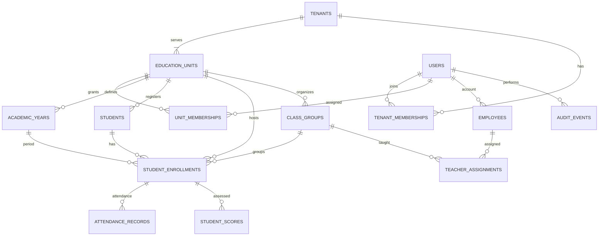

# ERD Konseptual SINAU

Diagram ini menunjukkan hubungan domain utama, bukan seluruh kolom atau constraint final.

## Interpretasi model pelanggan
- Tenant memiliki satu atau banyak education unit.
- tenant_type pada TENANTS membedakan foundation dan independent_provider.
- Tenant foundation dapat memiliki beberapa unit sekolah/madrasah.
- Tenant independent_provider mewakili sekolah/madrasah mandiri dan dibuat bersama unit pertama.
- Education unit tidak memerlukan relasi yayasan terpisah.
- Education type dan education level disimpan pada education unit; satu yayasan dapat menaungi sekolah umum dan madrasah dengan jenjang berbeda.

## Catatan integritas
- Setiap unit berada pada satu tenant aktif.
- Tenant membership tidak otomatis memberi akses semua unit; unit membership dan permission menentukan akses operasional.
- Tabel unit-scoped harus mempunyai scope terverifikasi dan constraint mencegah relasi lintas tenant.
- Tabel operasional memiliki referensi periode eksplisit.
- Transfer unit melalui workflow terotorisasi dan audit.

## Cakupan dan batas interpretasi diagram

Diagram di atas adalah peta relasi konseptual awal, bukan skema final. Baseline MVP yang disetujui mencakup tenant/unit, identity/access, subscription/entitlement, verification, konfigurasi institusi dan periode, kurikulum/mapel, student/guardian/enrollment, HR minimum, academic organization/assignment, attendance, assessment dasar, import/export, serta audit/file.

Entitas atau relasi untuk timetable engine lengkap, LMS, formal report-card workflow, PPDB end-to-end, finance, dan lifecycle siswa lanjutan berada pada roadmap/post-MVP. Keberadaannya pada model lama atau diagram lanjutan tidak menjadikannya bagian MVP.

### Domain ownership yang harus dipertahankan

- HR memiliki EmployeeProfile dan riwayat status/placement dasar.
- Academic Organization memiliki ClassGroup, TeachingAssignment, dan HomeroomAssignment; assignment merujuk profil pegawai HR.
- Identity & Access memiliki User, TenantMembership, UnitMembership, Role, Permission, dan assignment role. Profil pegawai/siswa tidak otomatis menjadi akun.
- Student memiliki StudentProfile, relasi wali, dan StudentEnrollment.
- Attendance dan Assessment harus merujuk enrollment/periode yang benar.
- Subscription/Entitlement, Verification, dan operational lifecycle merupakan concern terpisah.

### Batas teknis

Belum ditentukan kolom final, primary key strategy, nullability, unique constraints, composite foreign keys, RLS policy, cascade behavior, soft delete, retention, atau physical partitioning. Semua itu menunggu logical ERD, data dictionary, threat/privacy review, dan hasil PoC PostgreSQL.
