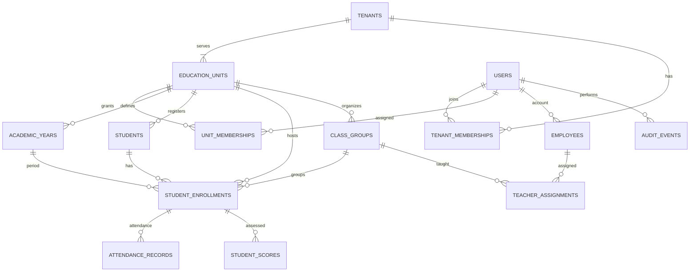

# ERD Konseptual SINAU

Diagram ini menunjukkan hubungan domain utama, bukan seluruh kolom atau constraint final.

## Interpretasi model pelanggan
- Tenant memiliki satu atau banyak education unit.
- tenant_type pada TENANTS membedakan foundation dan independent_provider.
- Tenant foundation dapat memiliki beberapa unit sekolah/madrasah.
- Tenant independent_provider mewakili sekolah/madrasah mandiri dan dibuat bersama unit pertama.
- Education unit tidak memerlukan relasi yayasan terpisah.
- Education type dan education level disimpan pada education unit; satu yayasan dapat menaungi sekolah umum dan madrasah dengan jenjang berbeda.

## Catatan integritas
- Setiap unit berada pada satu tenant aktif.
- Tenant membership tidak otomatis memberi akses semua unit; unit membership dan permission menentukan akses operasional.
- Tabel unit-scoped harus mempunyai scope terverifikasi dan constraint mencegah relasi lintas tenant.
- Tabel operasional memiliki referensi periode eksplisit.
- Transfer unit melalui workflow terotorisasi dan audit.
