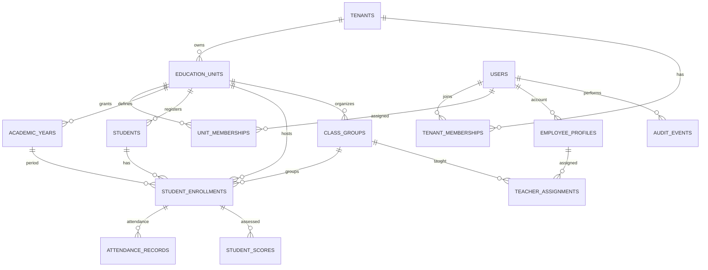

# ERD Konseptual SINAU

Diagram ini menunjukkan hubungan domain utama, bukan seluruh kolom atau constraint final.

## Catatan
- Diagram ini sengaja menyederhanakan beberapa tabel penghubung.
- Tenant/unit id harus hadir pada aggregate yang memerlukan scope dan constraint relasi harus mencegah referensi lintas tenant.
- Tabel operasional harus memiliki referensi periode yang eksplisit.
- Finalisasi ERD dilakukan setelah keputusan people/student/employee identity dan tenant ownership disepakati.
