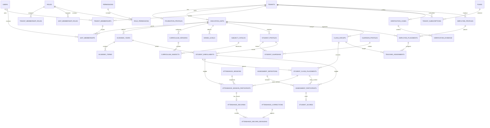

# Logical ERD SINAU — MVP

**Status:** Draft logical design v0.1.0 — belum disetujui untuk migration  
**Tanggal:** 2026-11-18  
**Basis scope:** `docs/02-requirements/MVP-SCOPE.md` (Accepted sebagai baseline perencanaan)  
**Ownership:** `DOMAIN-OWNERSHIP-MATRIX.md` v0.1.0  
**Database target:** PostgreSQL 18 (ADR-006); shared database/shared schema baseline (ADR-002).

> Dokumen ini menurunkan domain MVP ke kandidat tabel, key, dan relasi. Ini bukan migration SQL, bukan kontrak API, dan bukan persetujuan final atas seluruh atribut. Nama tipe ID, enum/reference implementation, RLS, index fisik, partitioning, retention, serta beberapa aturan cardinality masih menunggu ADR/PoC/review.

## 1. Konvensi logical design

1. Semua tabel memiliki primary key `id`; tipe fisik (UUID/ULID/identity) belum diputuskan. ID tidak menggantikan scope key.
2. Semua tabel tenant-scoped memiliki `tenant_id`; semua tabel unit-scoped memiliki `tenant_id` dan `unit_id`.
3. Tabel tenant/unit-scoped menyediakan candidate unique key `(tenant_id, id)` atau `(tenant_id, unit_id, id)` agar composite FK dapat membuktikan scope.
4. FK dari record unit-scoped ke unit harus memakai `(tenant_id, unit_id) -> education_units(tenant_id, id)`; jangan hanya memakai `unit_id`.
5. Timestamp teknis disimpan UTC; tanggal akademik menggunakan DATE bila tidak memerlukan waktu. Zona waktu tampilan berasal dari unit.
6. `created_at`, `updated_at` digunakan secara konsisten. `created_by_user_id`/aktor hanya ditambahkan pada entitas yang memerlukan attribution; audit event terpisah untuk aksi sensitif.
7. Status menggunakan nilai terkendali dan transisi tervalidasi. Nilai status berikut adalah kandidat domain, bukan daftar enum final.
8. Hindari cascade delete untuk histori akademik, pembayaran/subscription, membership, audit, dan file evidence. Penghapusan mengikuti retention/legal hold.
9. Field PII/anak/dokumen identitas tidak ditambahkan kecuali ada tujuan, klasifikasi, akses, dan retensi yang jelas.
10. Tenant/unit context wajib diverifikasi server-side pada request, job, queue, export, file access, dan raw SQL. RLS dievaluasi sebagai defense-in-depth.

## 2. Logical ERD — relasi utama

Diagram ini sengaja menampilkan relasi inti; tabel audit, import/export, file, dan detail status-history dijelaskan pada katalog di bawah.

## 3. Tabel platform, tenant, dan unit

### 3.1 `tenants` — platform/tenant boundary

| Kolom kandidat | Null? | Keterangan |
|---|---:|---|
| id | No | PK |
| tenant_type | No | `foundation` atau `independent_provider` |
| legal_name | No* | Nama organisasi/pelanggan; validasi kebutuhan registrasi |
| display_name | No | Nama tampilan |
| status | No | Status operasional tenant |
| timezone | No | Default tenant; unit dapat memiliki timezone sendiri bila disetujui |
| registration_completed_at | Yes | Pemicu deadline verifikasi 7 hari |
| created_at, updated_at | No | Timestamp UTC |

Candidate keys: PK `(id)`; unique `(id, tenant_type)` tidak diperlukan kecuali untuk subtype enforcement. `legal_name` bukan unique key global.

### 3.2 `foundation_profiles` — subtype tenant foundation

| Kolom kandidat | Null? | Keterangan |
|---|---:|---|
| id | No | PK |
| tenant_id | No | FK unik ke tenants.id |
| legal_form | Yes | Bentuk badan hukum |
| registration_number | Yes | Nomor pengesahan; akses terbatas |
| office_address | Yes | Alamat kantor |
| contact_name, contact_email, contact_phone | Yes | Kontak organisasi, klasifikasi PII |
| created_at, updated_at | No | Timestamp UTC |

Constraint: unique `tenant_id`; hanya tenant bertipe foundation boleh memiliki profile ini. Penegakan subtype membutuhkan trigger/controlled service atau desain FK subtype yang akan diputuskan; jangan mengandalkan UI.

### 3.3 `education_units` — unit pendidikan

| Kolom kandidat | Null? | Keterangan |
|---|---:|---|
| id | No | PK |
| tenant_id | No | FK ke tenants |
| unit_code | No | Kode internal unik dalam tenant |
| official_name | No | Nama resmi unit |
| display_name | Yes | Nama tampilan |
| education_type_code | No | Sekolah umum/madrasah/dll; referensi terkendali |
| education_level_code | No | SD/SMP/SMA/SMK/MI/MTs/MA/MAK/dll |
| npsn, nsm | Yes | Identifier resmi sesuai jenis unit; nullable saat onboarding |
| address, province_code, city_code, postal_code | Yes | Data lokasi sesuai kebutuhan |
| timezone | No | Zona waktu operasional unit |
| operational_status | No | Status operasional unit |
| created_at, updated_at | No | Timestamp UTC |

Candidate keys: PK `id`; unique `(tenant_id, id)`; unique `(tenant_id, unit_code)`; unique partial pada NPSN/NSM setelah aturan normalisasi/otoritas ditetapkan. Jangan gunakan unique global gabungan NPSN/NSM tanpa memisahkan namespace identifier.

## 4. Identity, membership, role, dan permission

### 4.1 `users` — global authentication identity

Kolom kandidat: `id` PK, `email_normalized` (unique global setelah kebijakan verifikasi), `email_verified_at`, `password_hash` atau credential reference, `account_status`, timestamps. Jangan menyimpan employee/student profile di tabel users. Credential eksternal/MFA dapat dipisah saat auth blueprint.

### 4.2 `tenant_memberships` — grant ke tenant

Kolom: `id`, `tenant_id`, `user_id`, `status`, `valid_from`, `valid_until`, `created_at`, `updated_at`.  
Keys: PK `id`; unique `(tenant_id, id)`; unique `(tenant_id, user_id)` untuk satu membership aktif/record kanonis per pasangan (riwayat perubahan status disimpan terpisah). FK `tenant_id -> tenants.id`; FK `user_id -> users.id`.

### 4.3 `unit_memberships` — grant ke unit

Kolom: `id`, `tenant_id`, `unit_id`, `tenant_membership_id`, `status`, `valid_from`, `valid_until`, timestamps.  
Keys: PK `id`; unique `(tenant_id, unit_id, id)`; unique `(tenant_id, unit_id, tenant_membership_id)`. FK `(tenant_id, unit_id) -> education_units(tenant_id, id)`; FK `(tenant_id, tenant_membership_id) -> tenant_memberships(tenant_id, id)`. Unit membership wajib memiliki tenant membership pada tenant yang sama; tidak otomatis memberi akses ke unit lain.

### 4.4 Role dan permission

- `roles`: `id`, `owner_scope` (platform/tenant/unit), nullable `tenant_id`, nullable `unit_id`, `code`, `name`, `is_system`, timestamps. CHECK scope: platform iff tenant_id dan unit_id NULL; tenant iff tenant_id NOT NULL dan unit_id NULL; unit iff tenant_id dan unit_id NOT NULL. FK unit role ke pasangan tenant/unit. Role platform tidak dapat dipakai sebagai role tenant/unit. Custom role memerlukan unique scope key yang sesuai.
- `permissions`: `id`, `code` unique, `description`, `resource`, `action`, `allowed_scope`; katalog permission terkelola.
- `role_permissions`: `role_id`, `permission_id`; composite PK.
- `platform_user_roles`: `user_id`, `role_id`; hanya platform-scoped role.
- `tenant_membership_roles`: `tenant_id`, `tenant_membership_id`, `role_id`; role harus tenant-scoped dan milik tenant yang sama.
- `unit_membership_roles`: `tenant_id`, `unit_id`, `unit_membership_id`, `role_id`; role harus unit-scoped pada tenant/unit yang sama.

Scope validation role membutuhkan CHECK constraint, composite FK, dan controlled write path yang diuji; role assignment tidak boleh hanya memeriksa role code di UI.

## 5. Subscription, entitlement, verification, dan lifecycle

- `plans` (platform): `id`, `code`, `name`, `version`, `status`; harga dan billing product dapat dipisah.
- `plan_entitlements` (platform): `plan_id`, `feature_code`, `limit_value`/configuration; definisi fitur/kuota.
- `tenant_subscriptions` (tenant): `id`, `tenant_id`, `plan_id`, `status`, `starts_at`, `ends_at`, `billing_reference`; status billing tidak disatukan dengan verification atau operational status.
- `tenant_entitlement_snapshots` (tenant): `id`, `tenant_id`, `subscription_id`, `feature_code`, `limit_value`, `effective_from`, `effective_until`; snapshot entitlement efektif agar perubahan paket dapat diaudit.
- `verification_cases` (tenant, optional unit): `id`, `tenant_id`, nullable `unit_id`, `subject_scope`, `status`, `registration_completed_at`, `deadline_at`, `submitted_at`, `decided_at`, `decision_by_user_id`, `decision_reason`. FK composite memastikan unit bila diisi berada pada tenant tersebut. Check constraint menjaga `subject_scope=tenant` iff `unit_id IS NULL`, dan `subject_scope=unit` iff `unit_id IS NOT NULL`.
- `verification_evidence`: `id`, `tenant_id`, nullable `unit_id`, `verification_case_id`, `stored_file_id`, `document_type`, `submitted_at`, `review_status`, `review_note`; evidence file private dan akses terbatas.
- `tenant_lifecycle_events` / `unit_lifecycle_events`: event append-only untuk suspend/close/transfer/restore; actor, reason, effective_at, correlation_id. Implementasi workflow detail tetap tunduk BP-PLT-06; transfer lintas tenant belum siap schema final.

## 6. Konfigurasi pendidikan dan kurikulum

- `academic_years` (unit): `id`, `tenant_id`, `unit_id`, `code`, `name`, `starts_on`, `ends_on`, `status`; unique `(tenant_id, unit_id, code)`; tanggal mulai <= akhir.
- `academic_terms` (unit): `id`, `tenant_id`, `unit_id`, `academic_year_id`, `code`, `name`, `starts_on`, `ends_on`; composite FK ke academic_years pada scope sama.
- `curriculum_versions` (unit): `id`, `tenant_id`, `unit_id`, `code`, `name`, `effective_from`, `effective_until`, `status`; berversi dan memiliki masa berlaku.
- `subject_catalog` (reference/platform): `id`, `code`, `name`, `subject_category`, `status`; apakah ada tenant override masih terbuka.
- `curriculum_subjects` (unit): `id`, `tenant_id`, `unit_id`, `curriculum_version_id`, `subject_catalog_id`, `grade_level_id` nullable, `local_code`, `display_name_override`, `weekly_load` nullable; unique sesuai curriculum/grade/subject dan scope.
- `grade_levels` (unit): `id`, `tenant_id`, `unit_id`, `code`, `name`, `sequence_no`; unique `(tenant_id, unit_id, code)`. Struktur tingkat tidak di-hardcode lintas tipe pendidikan.

## 7. Student, guardian, enrollment

Untuk menghindari keputusan prematur tentang shared `Person` lintas tenant, model MVP awal menggunakan profil siswa dan wali yang scoped ke unit. Ini **bukan** keputusan bahwa identitas global lintas sekolah tidak akan pernah ada; transfer/portabilitas identitas menunggu OWN-01/03.

- `student_profiles` (unit): `id`, `tenant_id`, `unit_id`, `local_student_no`, `full_name`, `birth_date` nullable, `gender_code` nullable, `profile_status`, timestamps. Unique `(tenant_id, unit_id, local_student_no)`; PII minimal dan akses terbatas.
- `guardian_profiles` (unit): `id`, `tenant_id`, `unit_id`, `full_name`, `contact_data` (structured columns, not arbitrary blob), `profile_status`, timestamps. Tidak otomatis merupakan users/login.
- `student_guardians` (unit): `id`, `tenant_id`, `unit_id`, `student_profile_id`, `guardian_profile_id`, `relationship_code`, `is_primary` candidate, `valid_from`, `valid_until`, `verification_status`. Composite FK kedua profile menjamin scope sama. Primary guardian uniqueness/aturan wali lebih dari satu menunggu policy.
- `student_enrollments` (unit): `id`, `tenant_id`, `unit_id`, `student_profile_id`, `academic_year_id`, `academic_term_id` nullable, `grade_level_id`, `class_group_id` nullable saat proses awal, `enrollment_no`, `status`, `effective_from`, `effective_until`. FK semua referensi scoped pada unit yang sama. Tidak menetapkan unique satu enrollment aktif per siswa sebelum OWN-02 disepakati; candidate unique enrollment_no per unit.
- `student_enrollment_status_history`: `id`, `tenant_id`, `unit_id`, `student_enrollment_id`, `from_status`, `to_status`, `effective_at`, `reason`, `changed_by_user_id`; append-only.

## 8. HR minimum dan academic organization

- `employee_profiles` (tenant): `id`, `tenant_id`, `employee_no`, `full_name`, `employment_status`, `contact_data` minimal, timestamps. Unique `(tenant_id, employee_no)`; tidak mengandung credential/login.
- `employee_status_history` (tenant): `id`, `tenant_id`, `employee_profile_id`, `from_status`, `to_status`, `effective_at`, `reason`, `changed_by_user_id`.
- `employee_placements` (unit): `id`, `tenant_id`, `unit_id`, `employee_profile_id`, `placement_type`, `starts_on`, `ends_on`, `status`; composite FK ke employee_profiles tenant yang sama dan unit yang sama. Mendukung penempatan seorang pegawai pada beberapa unit dalam satu tenant melalui placement terpisah; akses login tetap memerlukan membership/grant terpisah.
- `class_groups` (unit): `id`, `tenant_id`, `unit_id`, `academic_year_id`, `grade_level_id`, `code`, `name`, `capacity` nullable, `status`; FK academic year/grade scope sama; unique `(tenant_id, unit_id, academic_year_id, code)`.
- `homeroom_assignments` (unit): `id`, `tenant_id`, `unit_id`, `class_group_id`, `employee_placement_id`, `starts_on`, `ends_on`, `status`; assignment merujuk placement aktif yang valid dan memiliki effective dates.
- `teaching_assignments` (unit): `id`, `tenant_id`, `unit_id`, `class_group_id`, `employee_placement_id`, `curriculum_subject_id`, `starts_on`, `ends_on`, `status`; composite FK ke seluruh entitas unit/tenant; validasi overlap dan effective period.
- `class_subjects` (unit) dapat menjadi view/projection dari teaching assignment + curriculum subject bila tidak menyimpan fakta independen; jangan membuat tabel duplikat sebelum kebutuhan proses dipastikan.

## 9. Attendance dan assessment dasar

- `attendance_sessions` (unit): `id`, `tenant_id`, `unit_id`, `academic_year_id`, `academic_term_id` nullable, `class_group_id`, `session_date`, `session_label`, `starts_at` nullable, `ends_at` nullable, `created_by_user_id`, `status`. Session context minimal/manual; bukan timetable engine. Perlu keputusan apakah sesi wajib terkait teaching assignment.
- `attendance_records` (unit): `id`, `tenant_id`, `unit_id`, `attendance_session_id`, `student_enrollment_id`, `attendance_status`, `recorded_at`, `recorded_by_user_id`, `note` nullable. Unique `(tenant_id, unit_id, attendance_session_id, student_enrollment_id)`; status terkontrol. FK session dan enrollment memastikan scope sama.
- `attendance_corrections` (unit): `id`, `tenant_id`, `unit_id`, `attendance_record_id`, `previous_status`, `new_status`, `reason`, `requested_by_user_id`, `reviewed_by_user_id` nullable, `review_status`, timestamps. Alur approval minimum harus konsisten dengan BP-ACA attendance specification.
- `assessment_definitions` (unit): `id`, `tenant_id`, `unit_id`, `academic_year_id`, `academic_term_id` nullable, `class_group_id`, `curriculum_subject_id`, `code`, `name`, `assessment_category`, `max_score`, `weight` nullable, `assessment_date` nullable, `status`. Formal report card approval tidak termasuk MVP.
- `student_scores` (unit): `id`, `tenant_id`, `unit_id`, `assessment_definition_id`, `student_enrollment_id`, `score_value`, `feedback` nullable, `entered_by_user_id`, timestamps. Unique `(tenant_id, unit_id, assessment_definition_id, student_enrollment_id)`; FK memastikan enrollment berada pada class group/periode yang sesuai melalui service/domain invariant.
- `student_score_change_history`: `id`, `tenant_id`, `unit_id`, `student_score_id`, `old_value`, `new_value`, `reason`, `changed_by_user_id`, `changed_at`; append-only.

## 10. Import, export, audit, dan file

- `import_batches` (tenant; nullable unit target): `id`, `tenant_id`, `unit_id` nullable, `target_domain`, `source_file_id`, `status`, `requested_by_user_id`, `started_at`, `completed_at`, `summary`. Setiap row dieksekusi dengan authorization dan validasi domain target.
- `import_rows`: `id`, `tenant_id`, nullable `unit_id`, `import_batch_id`, `row_number`, `raw_payload_reference` (hindari menyimpan PII berlebihan), `validation_status`, `error_code`, `result_entity_id` nullable. Unique `(tenant_id, import_batch_id, row_number)`.
- `export_jobs`: `id`, `tenant_id`, nullable `unit_id`, `export_type`, `filters_reference`, `status`, `requested_by_user_id`, `stored_file_id` nullable, `expires_at`, timestamps. Authorization dievaluasi saat request dan saat artefak diunduh.
- `audit_events` (scope-aware): `id`, `tenant_id` nullable, `unit_id` nullable, `actor_user_id` nullable untuk system actor, `action_code`, `target_type`, `target_id`, `occurred_at`, `correlation_id`, `metadata_minimal`. Check constraint scope platform/tenant/unit; tidak menyimpan password, token, atau payload sensitif.
- `stored_files`: `id`, `tenant_id` nullable, `unit_id` nullable, `owner_domain`, `owner_entity_type`, `owner_entity_id`, `storage_key` opaque, `original_filename` sanitized, `mime_type`, `size_bytes`, `classification`, `scan_status`, `retention_until` nullable, timestamps. File object private; metadata tidak memberikan akses otomatis.

## 11. Candidate constraints dan index penting

| Area | Constraint/index kandidat | Tujuan |
|---|---|---|
| Tenant/unit | Unique `education_units(tenant_id,id)`; unique `(tenant_id,unit_code)` | Membuktikan scope dan mencegah kode unit duplikat per tenant |
| Membership | Unique `tenant_memberships(tenant_id,user_id)`; composite FK unit membership ke tenant membership | Tidak ada grant unit yatim atau lintas tenant |
| Role assignment | Composite FK role + membership sesuai scope | Mencegah role platform/tenant/unit salah dipasang |
| Academic period | Unique code per unit; check start <= end; overlap policy diuji | Konsistensi periode |
| Student | Unique local student number per unit; FK enrollment ke profile/unit | Identitas lokal dan histori enrollment konsisten |
| Class | Unique class code per year/unit; FK year/grade same unit | Tidak ada rombel lintas periode/unit |
| Attendance | Unique session + enrollment; index `(tenant_id, unit_id, session_date)` | Idempotensi presensi dan query rekap |
| Assessment | Unique assessment + enrollment; index enrollment/period | Mencegah nilai ganda dan mendukung rekap |
| HR | Unique employee number per tenant; FK placement tenant+employee | Pegawai hanya ditempatkan pada unit tenant yang sama |
| Verification | Index subject scope/status/deadline; composite FK unit+tenant | Pemantauan tenggat tanpa mencampur status subscription |
| Audit | Index scope + occurred_at; correlation_id | Investigasi dan audit trail |
| Export/file | Index scope/status/expiry; storage key unique | Akses privat dan cleanup sesuai retention |

Index final harus didasarkan pada query workload, EXPLAIN ANALYZE, dan benchmark, bukan ditetapkan dari perkiraan semata.

## 12. Keputusan yang belum boleh dikunci

| ID | Keputusan | Baseline sementara | Gerbang sebelum final |
|---|---|---|---|
| LERD-01 | Shared `Person` untuk siswa/wali/pegawai | Tidak dipakai lintas tenant pada MVP draft; profil lokal per unit dan pegawai per tenant | Privacy review, deduplication/use-case review |
| LERD-02 | Siswa memiliki beberapa enrollment aktif | Tidak diberi unique constraint global; enrollment dibatasi per unit/periode melalui aturan domain | Stakeholder validation + proses transfer/multi-unit |
| LERD-03 | Employee multi-unit | Didukung melalui beberapa EmployeePlacement dalam tenant yang sama; cross-tenant employment belum didukung | HR policy dan tenant/legal review |
| LERD-04 | Guardian login | Tidak otomatis; akun user dan unit membership terpisah | Guardian portal/access consent design |
| LERD-05 | Attendance session | Session manual berbasis tanggal dan class group; timetable engine tidak dibangun | Validasi guru/operator dan acceptance tests |
| LERD-06 | Catalog reference | Platform catalog sebagai kandidat; override tenant belum ditentukan | Curriculum/education configuration discovery |
| LERD-07 | Transfer unit antar tenant | Tidak direpresentasikan sebagai direct FK update; workflow/event saja | Legal, privacy, data ownership, export/import, ADR |
| LERD-08 | Role scope enforcement | Candidate composite FK + service validation | Authorization PoC, IDOR tests, RLS assessment |
| LERD-09 | Subtype tenant foundation | FoundationProfile 1:1, conditional type enforcement belum dipilih | PostgreSQL constraint/trigger PoC |
| LERD-10 | Retention, deletion, legal hold | Tidak ada cascade delete untuk histori; retention policy belum ditetapkan | Data classification and retention blueprint |

## 13. Risiko dan hal yang perlu ditinjau sebelum logical design diterima

- Student/guardian profiles per unit mengurangi risiko disclosure lintas lembaga tetapi dapat menyebabkan duplikasi identitas; ini adalah kompromi sementara, bukan solusi identity resolution.
- EmployeeProfile tenant-scoped memungkinkan penempatan lintas unit dalam satu tenant, tetapi HR visibility dan unit-specific access harus dipisahkan.
- `verification_cases` dengan optional `unit_id` membutuhkan check constraint dan scope-safe evidence FK.
- `stored_files`, `audit_events`, dan import/export memiliki relasi target yang tidak seluruhnya dapat dijamin FK polimorfik; owner reference perlu allowlist, authorization, dan audit.
- Keunikan NPSN/NSM, kombinasi education type/level, kalender overlap, enrollment concurrency, assignment overlap, dan attendance session uniqueness memerlukan aturan domain dan test.
- Tabel role dengan nullable tenant scope perlu desain constraint yang mencegah kombinasi scope ambigu; alternatif tabel role per scope boleh dipertimbangkan.
- Relasi nilai ke class group/subject/enrollment perlu invariant yang membuktikan enrollment memang bagian dari kelas dan kurikulum yang dinilai.

## 14. Acceptance criteria logical ERD

- [ ] Semua tabel MVP memiliki satu owner sesuai DOMAIN-OWNERSHIP-MATRIX.
- [ ] Scope setiap tabel jelas (platform/global, tenant, unit, atau global user).
- [ ] Semua FK unit-scoped membawa tenant_id + unit_id dan mencegah cross-scope reference.
- [ ] Membership, role, subscription, verification, dan lifecycle tetap merupakan concern terpisah.
- [ ] Enrollment, assignment, attendance, score, dan status history mempertahankan histori.
- [ ] Tidak ada keputusan identitas siswa/wali/pegawai lintas tenant yang diasumsikan final.
- [ ] Candidate unique/check/index constraints memiliki test case positif dan negatif.
- [ ] Field PII/dokumen memiliki purpose, classification, access, dan retention owner.
- [ ] Diagram konsisten dengan MVP-SCOPE, process specs, domain ownership, dan PostgreSQL PoC.
- [ ] Review domain, privacy/security, dan product owner selesai sebelum migration design.

## 15. Riwayat perubahan

| Tanggal | Versi | Perubahan |
|---|---|---|
| 2026-11-18 | 0.1.0 | Draft logical ERD pertama: entitas MVP, scope, candidate keys/FKs, relasi, constraints, dan keputusan terbuka. |

## 16. Remediasi logical model hasil audit AUD-LD-001 (proposal v0.2.0)

Bagian ini menjadi **candidate design terbaru** dan mengesampingkan deskripsi yang bertentangan pada bagian sebelumnya. Perubahan tetap Draft; belum merupakan persetujuan domain atau migration.

### 16.1 Enrollment dan histori penempatan rombel — AUD-LD-01

- Hapus `student_enrollments.class_group_id` sebagai sumber kebenaran. Enrollment merepresentasikan keikutsertaan siswa pada unit dan periode; enrollment boleh belum ditempatkan ke rombel.
- Tambahkan `student_class_placements` sebagai relasi penempatan efektif tanggal. Candidate owner: Student (karena lifecycle relasi enrollment); Academic tetap owner `class_groups`. Kontrak lintas domain dan owner final masih perlu persetujuan product/domain owner.
- Candidate attributes: `id, tenant_id, unit_id, student_enrollment_id, class_group_id, starts_on, ends_on, status, reason, created_by_user_id, created_at`.
- Satu enrollment dapat memiliki nol atau beberapa placement historis; rentang aktif untuk enrollment yang sama tidak boleh overlap. Gap diperbolehkan bila siswa belum ditempatkan atau ada jeda administratif.
- Placement harus berada pada unit yang sama, tahun ajaran/grade yang sesuai dengan enrollment dan class group, serta tanggalnya berada dalam masa enrollment. Candidate constraint: composite FK scope; composite key yang membawa `academic_year_id` dan `grade_level_id` untuk membuktikan kesesuaian enrollment/class group; temporal overlap ditangani exclusion constraint PostgreSQL atau transaksi terkunci setelah PoC.
- Tidak boleh mengubah placement lama untuk memindahkan siswa. Tutup `ends_on` secara terkontrol dan buat placement baru; koreksi histori memakai event koreksi/audit terpisah.

### 16.2 Attendance session participant snapshot — AUD-LD-02

Tambahkan `attendance_session_participants` sebagai snapshot roster yang dibekukan saat sesi dibuka/dipublikasikan:
- Attributes: `id, tenant_id, unit_id, attendance_session_id, student_enrollment_id, student_class_placement_id, eligibility_status, included_at, excluded_at, exclusion_reason`.
- Unique `(tenant_id, unit_id, attendance_session_id, student_enrollment_id)`; composite FK menjamin semua referensi dalam tenant/unit sama.
- Daftar awal berasal dari enrollment + placement yang berlaku pada `session_date`; siswa di luar enrollment/placement yang berlaku tidak boleh dimasukkan otomatis.
- Snapshot tidak berubah saat roster aktif berubah kemudian. Perubahan snapshot setelah sesi dibuat memerlukan tindakan khusus, alasan, actor, dan audit.
- `attendance_records` harus merujuk participant, bukan hanya enrollment. Candidate unique satu record per participant. Status awal konseptual `not_recorded` tidak dihitung sebagai absent.
- Sesi tetap manual/minimal dan tidak mengharuskan timetable engine. `teaching_assignment_id` pada sesi bersifat nullable untuk sesi kelas umum; bila diisi, wajib cocok dengan class group, subject, unit, dan tanggal efektif. Sesi tanpa assignment hanya dapat dibuat oleh role/petugas dengan permission eksplisit. Apakah sesi MVP per kelas atau per pelajaran tetap keputusan terbuka OWN-05/DD-07.

### 16.3 Assessment participant dan basic result lifecycle — AUD-LD-03

Tambahkan `assessment_participants` untuk membekukan peserta berdasarkan enrollment + placement pada tanggal asesmen:
- Attributes: `id, tenant_id, unit_id, assessment_definition_id, student_enrollment_id, student_class_placement_id, eligibility_status, included_at, excluded_at, exclusion_reason`.
- Unique `(tenant_id, unit_id, assessment_definition_id, student_enrollment_id)`; scope FK dan kesesuaian class/period/division harus dibuktikan.
- `student_scores` menjadi hasil untuk participant, bukan pasangan bebas assessment/enrollment. Candidate result fields: `assessment_participant_id, result_status, score_value nullable, feedback, workflow_status, finalized_by_user_id nullable, finalized_at nullable`.
- `result_status` membedakan `pending`, `scored`, `absent`, dan `exempt`. `score_value` wajib hanya ketika status `scored`; nilai 0 tetap nilai numerik yang sah. Tidak adanya row tidak boleh diam-diam diartikan nol.
- `workflow_status` MVP dibatasi pada `draft` dan `finalized` sebagai kandidat; status final hanya setelah otorisasi yang sesuai. Publikasi portal/rapor formal, multi-stage moderation, remedial/retake, multiple attempts, dan formula rapor tetap post-MVP kecuali change request disetujui.
- `assessment_definitions` menyimpan `scoring_rule_version` dan `scoring_rule_snapshot` terstruktur/tervalidasi (bukan kode yang dieksekusi). Snapshot dibekukan ketika hasil pertama dicatat; perubahan aturan membuat versi baru dan tidak mengubah hasil historis.
- Bobot, skala, presisi, kategori, dan siapa yang boleh finalisasi tetap mengikuti DD-09 serta keputusan kebijakan unit; dokumen ini tidak menetapkan angka atau formula universal.

### 16.4 Academic cross-entity integrity — AUD-LD-04

Setiap transaksi harus membuktikan seluruh rantai berikut:
1. Session → unit, academic year/term, class group, optional teaching assignment.
2. Session participant → session, enrollment, placement yang berlaku pada tanggal sesi; enrollment dan placement berada pada class group/periode yang sama.
3. Assessment definition → unit, academic year/term, class group, curriculum subject yang valid untuk grade/kurikulum/periode.
4. Assessment participant → assessment, enrollment, placement yang berlaku pada assessment date; class/grade/period cocok.
5. Teaching/homeroom assignment → employee placement, class group, curriculum subject (bila ada), dan tanggal efektif yang seluruhnya cocok.

Strategi enforcement dibagi:
- **Database FK/UNIQUE/CHECK:** scope tenant/unit, referensi wajib, composite parent keys, valid date order, status allowlist, uniqueness/idempotency.
- **Database temporal constraint atau serialized write:** larangan overlap placement/assignment pada kombinasi yang relevan; kandidat PostgreSQL exclusion constraint dengan range tanggal. Wajib diuji dengan concurrent transaction.
- **Domain service dalam transaksi:** aturan yang bergantung pada policy dan effective-date joins yang tidak dapat dinyatakan aman dengan FK sederhana. Service harus lock aggregate/rows terkait, revalidate sebelum commit, dan idempotent.
- **Read/report query:** wajib memakai placement/participant snapshot yang berlaku pada tanggal transaksi, bukan current class.
- Tidak boleh hanya mengandalkan validasi UI atau client.

### 16.5 Attendance correction dan immutable revision — AUD-LD-05

- `attendance_records` adalah identity/current projection; nilai status historis yang authoritative disimpan pada `attendance_record_revisions`.
- Tambahkan `attendance_record_revisions`: `id, tenant_id, unit_id, attendance_record_id, revision_no, attendance_status, note, source_correction_id nullable, changed_by_user_id, changed_at`. Unique `(tenant_id, unit_id, attendance_record_id, revision_no)`; unique `source_correction_id` bila tidak null agar satu correction menghasilkan paling banyak satu revision.
- `attendance_corrections` menjadi request lifecycle: `requested_status`, `reason`, `requested_by_user_id`, `review_status`, `reviewed_by_user_id`, `reviewed_at`, `applied_revision_id`, `applied_by_user_id`, `applied_at`, `idempotency_key`.
- State candidate: `requested → approved/rejected → applied`. Approval bukan berarti applied. Rejected tidak boleh menghasilkan revision.
- Approval, pengecekan revision saat ini, pembuatan revision, update projection, dan penandaan applied harus satu transaksi; retry menggunakan idempotency key dan tidak boleh membuat revision kedua.
- Apakah semua koreksi wajib approval atau hanya setelah submit/lock tetap kebijakan terbuka DD-08. Model mendukung policy gate tanpa menganggap semua koreksi selalu perlu approval.

### 16.6 Effective dating HR/Academic — AUD-LD-07

- `employee_placements`, `homeroom_assignments`, dan `teaching_assignments` wajib memiliki `starts_on`, nullable `ends_on`, check `ends_on >= starts_on`, status terkendali, dan scope composite FK.
- Assignment tidak boleh melampaui rentang placement pegawai; subject harus berasal dari curriculum version yang berlaku dan cocok dengan grade/class group.
- Overlap yang dilarang didefinisikan per business key (misalnya satu homeroom assignment aktif per class group, atau assignment guru-mapel yang bentrok) dan tidak boleh diasumsikan satu aturan untuk semua tipe assignment.
- Perubahan employment status tidak menghapus assignment historis. Perubahan yang memengaruhi masa depan harus menutup/menangguhkan assignment dengan effective date dan audit melalui transaksi HR→Academic yang terkoordinasi.
- Constraint temporal/locking dan concurrency test wajib dibuktikan pada PoC PostgreSQL sebelum physical design.

### 16.7 Audit actor contract — AUD-LD-09

Candidate contract `audit_events`:
- `actor_type` wajib dan allowlisted: `user`, `system`, `service`, `support`.
- `actor_user_id` wajib untuk `user` dan `support`; null hanya untuk `system`/`service`.
- `actor_service_code` wajib untuk `system`/`service`; support action wajib memiliki support session/reference dan reason.
- `correlation_id` wajib untuk semua event; request/job ID dapat disimpan terpisah bila perlu.
- CHECK constraint mengikat actor_type dengan kolom actor terkait. User actor harus diverifikasi terhadap scope; system/service identity berasal dari allowlist terkelola.
- Audit append-only bagi aplikasi; update/delete dibatasi pada proses retensi khusus. Tamper-evidence, key management, dan immutable sink tetap keputusan security architecture.

### 16.8 File reference dan akses — AUD-LD-08

- Generic `stored_files.owner_entity_type/owner_entity_id` hanya metadata routing, bukan FK atau grant akses.
- Owner type/domain harus allowlist; file scope wajib sama dengan owner scope dan diverifikasi pada attach/read/download/delete serta job async.
- Dokumen sensitif (student, guardian, HR, verification) harus menggunakan typed association table/record FK milik domain terkait bila dibuat; jangan mengandalkan generic polymorphic reference sebagai satu-satunya bukti ownership.
- Storage object private; MIME dideteksi server, malware scan wajib sebelum tersedia, signed URL singkat bila digunakan, revoke melalui authorization pada setiap permintaan, audit akses dan retention sesuai policy.
- Export file hanya dapat diunduh oleh requester atau role yang masih memiliki permission aktif; re-check scope/membership saat download, bukan hanya saat job dibuat.

### 16.9 MVP boundary dan traceability — AUD-LD-10

| Capability | MVP candidate | Post-MVP / excluded unless approved |
|---|---|---|
| Student enrollment + class placement history | Ya, minimum placement efektif tanggal | Transfer lintas tenant dan shared person |
| Attendance | Session manual/minimal, participant snapshot, status dan correction audit | Timetable engine, biometrik/GPS/QR default, offline sync |
| Assessment | Basic assessment, participant snapshot, score/status, simple finalization and recap | Rapor formal, multi-stage moderation, remedial/retake, multiple attempts, portal publication |
| HR | Employee profile/status/placement minimum | Payroll, cuti, kontrak rinci, employee attendance |
| Guardian | Relationship/contact minimum sesuai kebutuhan dan privacy approval | Guardian login/portal, claim/invitation and delegated access |
| Files/audit | Metadata private, scope check, actor and access audit | Advanced document workflow/e-signature and immutable external archive |

Setiap requirement MVP wajib ditrace ke process ID, entity/table, owner, permission, test case, dan release. Process spec yang menjelaskan alur post-MVP bukan izin memasukkannya ke MVP.

### 16.10 Acceptance dan test matrix minimum

| Test ID | Skenario | Expected result |
|---|---|---|
| LD-01 | Enrollment tanpa placement | Valid; tidak ada current class fiktif |
| LD-02 | Dua placement overlap untuk enrollment yang sama | Ditolak oleh DB temporal constraint atau serialized transaction |
| LD-03 | Placement pada unit/tahun/grade berbeda dari enrollment/class | Ditolak |
| LD-04 | Sesi dibuat; roster berubah setelah sesi ditutup | Snapshot peserta sesi tetap |
| LD-05 | Record presensi untuk enrollment di luar snapshot | Ditolak |
| LD-06 | Retry submit presensi/koreksi dengan idempotency key sama | Satu record/revision saja |
| LD-07 | Nilai status absent/exempt/pending tanpa angka | Valid dan tidak dihitung sebagai zero |
| LD-08 | Nilai scored dengan angka 0 | Valid sebagai zero |
| LD-09 | Nilai di luar max_score atau peserta dari kelas/periode lain | Ditolak |
| LD-10 | Ubah scoring rule setelah nilai final | Hasil lama tidak berubah |
| LD-11 | Approval koreksi tanpa apply | Tidak mengubah current attendance projection |
| LD-12 | Dua koreksi bersamaan pada revision sama | Konflik terdeteksi; tidak ada lost update |
| LD-13 | Teaching assignment di luar masa employee placement | Ditolak |
| LD-14 | Actor system tanpa service identity/correlation | Ditolak |
| LD-15 | File ID lintas tenant/unit atau membership revoked | Akses ditolak, termasuk signed/download/job |
| LD-16 | Session/assessment transaction dengan tenant benar tetapi academic context salah | Ditolak |

## 17. Riwayat perubahan

| Tanggal | Versi | Perubahan |
|---|---|---|
| 2026-11-18 | 0.1.0 | Draft logical ERD pertama. |
| 2026-11-18 | 0.2.0 | Proposal remediasi audit: placement, participant snapshots, result lifecycle, cross-entity invariants, revisions, effective dating, actor contract, file authorization, MVP boundary, dan test matrix. Menunggu domain/privacy/security/product approval. |
